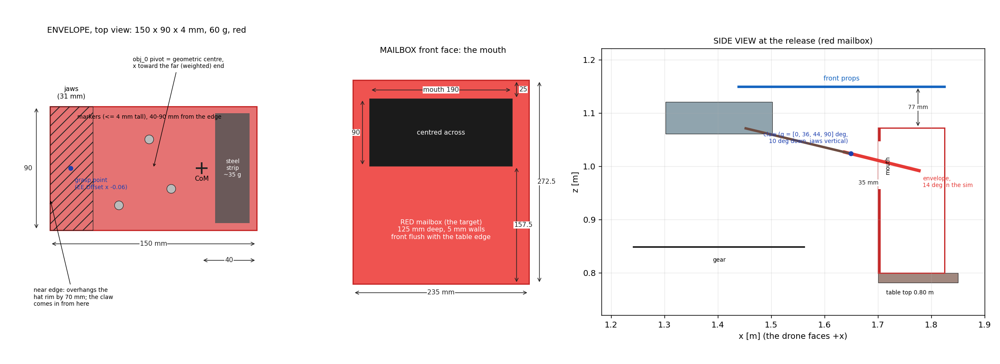
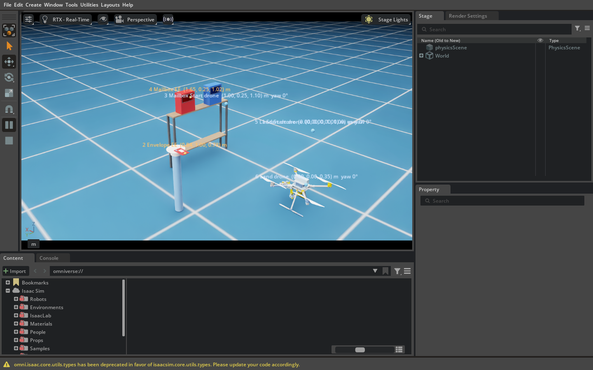

# 2026-10-23 — Mail delivery: the final pick-and-place experiment

User design (2026-10-23, sketch): the AM takes off, flies front-left to the pick pillar, picks a RED
ENVELOPE lying flat on the pillar's hat, flies to two mailboxes (235 L × 125 W × 272.5 H mm) fixed on the
thin console table (the box-pushing table), and slides the envelope through a rectangular mouth in the
front of the RED mailbox. The BLUE mailbox is scenery. Because the envelope lies flat, the wrist roll J4
turns 90° so the jaws close vertically; J4 is the arm's softest joint, so the payload must stay light. The
envelope's size and mass and the mouth's size and position were left to this study, sized from the flight
data; the arm GS gets a "Mail Envelope" tab reusing the pick-and-place logic.

The arm GS's new tab, live: `shots/gs_live_mail_tab.png`.

## 1. The design

### The binding constraint is the mailbox's 125 mm depth (115 mm inside)

At the release three things must hold at once, each with the claw's fore-aft hover error:

* the jaw tips stay **outside** the wall,
* the envelope's far end stays **short of the back wall**,
* its **centre of mass is past the mouth's lip**, or it falls back out when the jaws open.

With the jaws gripping the near edge and ±20–30 mm of error, a UNIFORM envelope cannot satisfy all three
in a 115 mm deep box, at any insertion angle. Its centre of mass is L/2 from the tip, but the box only
admits ~110 mm and the jaws need ~60 mm outside (worked out in `tools/mail_geometry.py`). The way out is a
**weighted far end**: the printed core carries a steel strip there, so the centre of mass sits 40 mm from
the far end. A shorter envelope then has its centre of mass inside the box while the jaws are still
35 mm out. The same weighting makes the pick easy: the near edge can overhang the hat by 70 mm, giving the
jaws room, while the centre of mass is still 40 mm inside the rim (60 mm short of the hat's centre).

### The envelope

| | |
|---|---|
| size | **150 × 90 × 4 mm** (a 2 mm PLA core in red paper); long axis = the approach direction |
| mass | **60 g** (core + paper ~25 g spread over the length, steel strip ~35 g centred 15 mm from the far end; 55–65 g is fine) |
| centre of mass | **40 mm from the far end** |
| on the hat | flat, long axis along the drone's approach, near edge **70 mm past the hat's rim** |
| grasp | 15 mm inside the near edge (EE Offset x −0.06); the jaw tips reach 31 mm in |
| mocap body obj_0 | pivot at the geometric centre, x along the long axis toward the far (weighted) end, z up; low-profile markers (≤ 4 mm tall) on the top face 40–90 mm from the near edge, clear of the jaws |

* **Why 60 g: J4 is not what limits it.** At q4 = 90° with the envelope gripped by its edge, its centre
  of mass lies on the claw axis, so gravity puts almost no torque on J4. The only J4 load is m·g × the
  lateral grip offset: 24 mN·m at 40 mm, against a heading stiffness of 0.445 N·m/rad (the 10-16 j4 fix),
  i.e. ~3°. Keeping it light keeps the other loads small: the pinch moment the jaws resist (56 mN·m), and
  the lift/release kicks on j2/j3 that the 190 g basket made (+18..25° q2 at release). Those scale with
  mass, so expect a few degrees here.
* **Downwash.** A flat plate presents almost no frontal area to the outwash. The basket that moved
  21 mm on the hat (10-10) was 65 mm tall. At 60 g the envelope's friction (~0.2 N) is well above the
  edge drag.
* **Stiffness.** A 2 mm PLA core deflects ~1 mm under its own tip mass when held by its edge; 1 mm would
  sag ~10 mm.

### The grasp pose: [0, 36, 44, 90] deg (pick = carry = place)

* β = q2 + q3 = 80° is the folded home's fold: the claw points 10° below level, 0.247 m ahead of and
  0.068 m below the body origin.
* q4 = 90° turns the jaws to close 10° off vertical, so they pinch the flat envelope.
* q2 is 9° from the real arm's +45 stop and q3 is 6° from +50; σ_nd 0.347.
* A level claw (β = 90°) would need q2/q3 on their stops.
* **The heading task is not singular at q4 = 90°.** The law's 4th task row is the rotation about the
  claw's own axis (`wb_controller.cpp`, b3e = the claw axis), and the planner streams the full 3-D FK
  frame (`flatState`: `b1_de = (R0 Re) e1`).

### The mouth: 190 × 90 mm, centred across the face, top edge 25 mm under the box top

(i.e. 157.5 mm above the box bottom to 247.5 mm). Sized from the measured hover error
(`hover_error/README.md`, 13 hardware flights 10-09..10-21). The unloaded claw at a hold:

* lateral p95 26–29 / p99 41–43 mm
* vertical p99 8 mm
* at the moment the GS fires the gripper (its 20 mm gate): 3-D median 10, max 32 mm

The envelope in the jaws is pitched **0–20°** nose-down: the claw's 10°, plus its weight moment rotating
it in the pinch. The sim measured 8° with a centred grip and 14° with a 21 mm off-centre one. So the
section crossing the wall plane spans −48..+6 mm about the claw over the insert. With ±12 mm vertical,
±40 mm lateral and ±20 mm fore-aft, every margin stays positive (`mail_geometry.py`):

| margin (after the error budget) | mm |
|---|---|
| band below / above the mouth | +6 / +5 |
| each side (envelope 90 in a 190 mouth, ±40 lateral, 2° yaw in the jaws) | +5 |
| jaw tips to the wall, envelope tip to the back wall (fore-aft +) | +15 |
| centre of mass past the lip (fore-aft −, 10 mm kept) | +8 |
| pick: jaw tips to the hat rim / 10 mm of grip left | +9 / +1 |
| front props over the mailbox top, incl. a 3° nose-down pitch | +55 (77 nominal) |

**The props decide the mouth's height.** At the release the body is 0.30 m in front of the wall, but the
front rotor discs reach 0.423 m ahead of the body. They pass 125 mm over the box top, so the claw must
be high enough to keep them 77 mm above it. That is why the mouth is near the top of the face.

### The layout (scene defaults; sim yaml values)

* **Vehicle:** start mark (0.10, −0.07), yaw 0. The drone yaw is **0 throughout**.
* **Pick pillar** (1.0, 1.0), 0.77 m under the hat. The envelope centre is at (0.905, 1.0, 0.780), near edge
  toward −x.
* **Table** front edge x = 1.70, centred on y = 0. Mailboxes with their fronts flush with it: **red at y = +0.25**,
  blue at y = −0.25 (0.5 m apart, so the right front prop barely reaches the blue box).
* **Mailbox Start** (1.0, 0.25, 1.10). **Place point** (envelope centre at the release) (1.709, 0.25, 1.024)
  = claw 21.5 mm above the mouth's centre, 9 mm past the front face. Insert Margin 0.15 m.
* **Land Start / Land** (0, 0, 1.0 / 0.35).

## 2. What was built (all additive; the pick-and-place and pick-and-drop paths are unchanged)

* **Planner** (`fsc_trajectory_planner`): `pick_place_place_insert` + `pick_place_place_approach_back`
  (`PickPlaceConfig::place_insert`).
  * Ready To Place holds the claw the Insert Margin behind the place target at its height; Place slides it
    straight in (the hook pick's level approach, mirrored to the place).
  * Exit backs out `pick_place_place_exit_back`, then climbs.
  * Refused with `place_drop`, or with a margin ≤ 0. Status wording: "press Insert to slide in".
  * gtest `TheInsertPlaceApproachesLevelFromBehindAndSlidesStraightIn`; pick-place suite 31/31.
* **Arm GS** (`utils_custom_ground_station`): `PickPlacePanel::Mode {kSetDown, kDrop, kMail}` and a new
  **"Mail Envelope"** tab at the end (tab index 8).
  * Labels: Envelope / Mailbox Start / Mailbox; Ready To Insert / Insert / Exit To Insert.
  * An **Insert Margin** box (`pick_place_place_approach_back`).
  * Its Plan switches the planner to the insert place (`place_drop` false, `place_insert` true); the other
    two tabs' Plan switch `place_insert` off. Only the matching tab acts on the gripper.
  * The pick closes only centred **vertically** (`pick_place_grip_vertical_tol`, 8 mm: the jaws close
    vertically).
  * The insert opens the gripper once the claw is within 20 mm. **Exit To Insert starts only on the OPEN
    report** (`pick_place_auto_exit_mail`), so the jaws never drag the envelope back out. The gripper
    closes after the exit.
  * Abort service `mail_envelope_panel/abort`.
* **Isaac scene** `application/robotic_arm/07_px4_t650_aerial_manipulator_mail_delivery.py`.
  * It loads the pick-and-place scene as a module, like every 07 loads 06.
  * T650 gear, real q2 stops [−20, 45]; the pick pillar + hat, the console table, the two hollow
    mailboxes with their mouths, the envelope (obj_0, weighted, 20 mm invisible grip pad on its near
    45 mm).
  * Prints the envelope's state on every change ("IN THE RED MAILBOX").
  * Knobs `PEGASUS_MAIL_*`.
* **Configs.** `make_pick_place_yaml.py` profile **mail_delivery** writes `..._t650_sim_mail_delivery.yaml`
  (the mirror's controller + the mail task block). `make_hw_pick_and_place_yamls.py` writes the hardware
  `..._t650_mail_delivery.yaml` (the pick-and-drop's controller + the same task block).
* **Launch.**
  * `WB_SIM_PROFILE=mail_delivery` is accepted by `am_plant_from_yaml.sh`, both 4-D sim stacks, and the
    pick-and-place scene wrapper (which then runs the mail scene and opens the arm GS on tab 8).
  * `AM_HW_PROFILE=mail_delivery` is accepted by both whole-body hardware stacks. They refuse the SIM mail
    yaml, and a planner build without `pick_place_place_insert`.
* **Tools** (`tools/`): `mail_geometry.py` (every design number), `mail_drawing.py`, `mail_score.py`,
  `run_mail.sh` / `chain1.sh` (headless flights), `mail_gs_check.sh` + `mail_rig.py` + `gs_harness/` (the
  tab against the real planner, no Isaac). `pnp_mission_v2.py` gained `--mail`.

## 3. Results

### The tab against the real planner (no Isaac): ALL PASS

`tools/mail_gs_check.sh <gs_mail_snapshot> <out>` runs the real planner on the sim mail yaml, the real
tab offscreen, and a loopback rig pressing the tab's own buttons, on ROS domain 77. Checks:

* the tab is inactive while the planner flies another place, and its Plan switches it;
* q4 = 90° from Ready To Pick through the carry;
* Ready To Insert holds exactly 150 mm behind the target, level;
* the close happens only on the target, and Exit To Pick by itself;
* the open happens on the target, and Exit To Insert only after the OPEN;
* the gripper closes after the exit, and the arm folds home (q4 0) by Land Start.

Snapshots: `shots/`.

### Isaac, headless, whole-body 4-D L1 rig (RTF 1)

`tools/run_mail.sh <tag>` runs one flight (`MAIL_FEEDBACK=raw|fused`), driven by `pnp_mission_v2.py --mail`
(the tab's sequence, gripper via the action). `tools/mail_score.py` scores it.

All four missions completed (pick → carry → insert → release → exit → land) with 0 aborts. mail2–4 fly
the final configuration:

| run | feedback | envelope ends | mouth margin below / above / side [mm] | jaw tips → wall | far end → back wall | props over box | pitch in the jaws, mean (min–max) | claw error at close / open (3-D) | peak tilt pick / carry / insert |
|---|---|---|---|---|---|---|---|---|---|
| mail1 † | raw | in the box, **hung on the lip** | (80 mm mouth) | 27 mm | 39 mm | 71 mm | 13.9° (7–18) | 21 / 9 mm | 2.6 / 2.5 / 2.8° |
| mail2 | raw | **on the floor of the red box** | 36 / 17 / 42 | 35 mm | 35 mm | 75 mm | 8.2° (6–11) | 6 / 9 mm | 2.9 / 2.7 / 3.4° |
| mail3 | raw | **on the floor of the red box** | 30 / 18 / 45 | 35 mm | 27 mm | 78 mm | 10.9° (8–14) | 10 / 11 mm | 3.1 / 2.8 / 4.2° |
| mail4 | **fused** (the hardware path) | **on the floor of the red box** | 29 / 24 / 45 | 41 mm | 43 mm | 74 mm | 12.9° (12–14) | 17 / 15 mm | 4.0 / 2.9 / 3.1° |

† mail1 is the first flight: 80 mm mouth, claw 9.5 mm above its centre. It showed the two things fixed
afterwards:

* The envelope rides **pitched 7–18° in the jaws** (its weight moment in the pinch), not ≤10°. The claw was
  raised to 21.5 mm above the mouth's centre and the mouth made 90 mm.
* The invisible grip pad **hooked the mouth's lip**: the envelope stood vertical inside, hanging from it.
  This is a sim artifact; the pad's collider now goes off when the jaws open at the mailbox.

Other observations:

* q4 held 90–95° through every carry.
* The pitch tracks the grip offset: 8° with a 6 mm grip error, 13–14° with 17–21 mm. The heavy end hangs
  further when the jaws take the envelope off-centre.
* The released envelope falls and comes to rest on the box floor standing on its end (90–130°). The box is
  only 125 mm deep against the 150 mm envelope, so it stands rather than lies flat.
* Every margin stayed ≥ 17 mm; the closest was the band above the mouth (17–24 mm) and the back wall
  (27 mm).

Data in `runs/` (npz, driver / stack / scene / Isaac logs, `*.score.txt`).

## 4. On the hardware

* **Fly the EKF2-fused stack** (no contact: the pick-and-drop's path):
  `AM_HW_PROFILE=mail_delivery start_whole_body_l1_4d_direct_actuation_stack_t650_aerial_manipulator_fused.sh`.
  Orin: pull and rebuild `fsc_trajectory_planner`. Laptop: rebuild `utils_custom_ground_station`.
* **Envelope row:** the envelope on the hat as designed, then Get. Check the yaw is the drone's approach
  heading.
* **Mailbox row:** lay the envelope flat on the mouth's lower lip, pushed in until its far end touches
  the back wall, hold it level (its centre of mass is then inside and it would tip in), then Get. By hand:
  **x − 0.036** along the heading (the design release is 36 mm short of that touch point) and **z + 0.065**
  (the claw rides 64.5 mm above an envelope lying on the lip). Type yaw 0 (facing the mouth). The boxes
  show two decimals, so set the exact value with `ros2 param set`: rounding to x − 0.04 / z + 0.06 puts the
  claw 4.5 mm low and leaves 1.5 mm of the 6 mm room below the mouth.
* **Hover ≥ 6 s before Insert.** The descent trim averages the claw's error over its window (5 s on
  hardware) and cancels the standing part.
* **Open items:**
  * The real OM-X gripper's open gap at the fingertips. The sim's is 37 mm; the envelope needs ~4 mm
    plus the vertical error.
  * How the foam pads hold a 4 mm plate. Its pitch in the jaws is assumed 0–20°.
  * The props' downwash on the box top. They pass 77 mm over it for ~3 s. The 10-14 bin drove a 0.6 Hz
    pitch oscillation from 1.3 m; watch it on the first flight.
  * The mailboxes' real wall thickness (5 mm assumed). Every distance above is measured from the outer
    faces.

## 5. The printed core (2026-10-28)

For the real envelope the user prints a PLA core and wraps it in red paper. `cad/make_envelope_core.py`
writes `cad/envelope_core.stl` (closed mesh, checked), `cad/envelope_core.scad` (the same dimensions) and
`cad/envelope_core.json`. Page with 3-D views, fully dimensioned drawings of both parts and a zip download:
artifact "Envelope Mailing Design" (https://claude.ai/artifact/T9kobBuoNJnUzeepCZpkiw), which also carries
the localization frame (§6).

* **Rev C (current, user request): all PLA, no steel.** The user has no steel bar and wants the whole part
  printed; the centre of mass is no longer treated as a hard requirement.
  * 150 × 90 × 3.8 mm plate (~4.1 mm wrapped). Datum = the near-edge / right-edge corner of the bottom face.
  * Solid grip band 0–35 mm. Four 30 × 36 mm through-windows with corners at x 35 / 71, y 6 / 48 (pattern
    pitch 36 along x, 42 along y), 6 mm webs everywhere. Solid far band 101–150 mm.
  * Estimate (3 walls, 4/4 top/bottom layers, 20 % infill): **29.5 g, centre of mass 73 mm from the far end**.
    Optional slicer modifier over the far band at 100 % infill: **38.6 g, 62 mm**. No geometry change.
* **What dropping the steel costs** (`tools/mail_geometry.py` with each option's centre of mass; ±20 mm fore-aft):
  | option | inside the hat's rim | past the mouth's lip | worst release margin |
  |---|---|---|---|
  | as drawn | 7 mm | 5 mm | −25 mm |
  | as drawn, release 15 mm deeper | 7 | 20 | −10 |
  | far band 100 % infill | 18 | 16 | −14 |
  | far band solid, release 15 mm deeper | 18 | 31 | **0** |
  | rev B (steel bar) | 40 | 38 | +8 |

  "Deeper" = +15 mm on the place offset's dx (jaw tips 20 mm from the wall instead of 35). The planner and the
  offsets were NOT changed: whether to release deeper is the user's call. On the hat, the balance point only
  7 mm inside the rim means prop wash on the 70 mm overhang can tip the envelope before the grasp.
* Rev B (steel bar 20 × 3 × 84 mm in a far-end pocket, 65 g, centre of mass 40 mm) and rev A are superseded;
  artifact version 3 still shows rev B.
* The `.scad` was not rendered here (no OpenSCAD on this machine). The STL is generated directly.

## 6. The localization frame (rev B, 2026-10-29)

One printed frame localizes BOTH targets for the ground station's Get. `cad/make_localization_frame.py` writes
`cad/localization_frame.stl` (closed mesh, checked), `.scad`, `.json` and `localization_frame_assembly.stl`
(plate + holders + markers, to look at). Frame axes: origin O at the centre of the UNDERSIDE, +x = the drone's
travel at that step, z up.

* **Registration:** 208.6 × 200 mm, 4 mm plate, two skirts 3 mm below its ±x ends.
  * **On the hat:** the skirts' inner arc R 100.3 (the REAL cap, measured Ø200 by the user on 2026-10-29, + 0.3)
    drops over the rim and centres the frame. Yaw is free: set it along the approach. Until then the frame was
    sized on the sim's Top_Hat (Ø200.6, R 100.6, 209.2 long, stop −20.3, pick −0.0917); the sim asset is
    unchanged, so the simulated hat is 0.3 mm larger a side than the real one.
  * **On the mailbox:** the skirts' flats, 125.6 mm apart (125 + 0.6), close on the front and back faces,
    which fixes x and yaw. Centre y by eye: the ends sit 17.5 mm in from each side.
  * **The U-slot is the envelope's placement jig on the hat:** 90.6 wide, open to −x, stop at x = −20.0.
    Slide the envelope in, far end first, then lift the frame off. Its centre is then at (−95.0, 0): its near
    edge 70 mm past the cap's rim, as before.
* **Five markers on the user's own holders (rev B; rev A's posts and window are gone).**
  `cad/extract_marker_holders.py` splits `Valve_Assembly_v2.stl` into shells and writes the four holder
  designs (`cad/holders/holder_{A,B,C,D}.stl`, `marker_*.stl`, `holders.json`, each in its own frame: origin =
  the centre of the base's bottom face). The valve's fifth marker sits on a mount that is part of the rotor,
  so it has no separate holder and is skipped. The markers are the user's standard Ø30 balls on a tab; all
  five are the same part, and only the holder sets the height and offset.
  * Each holder glues into a 2 mm pocket, its base + 0.2 mm a side (rounded to 0.5 mm), so it stands at a fixed
    height and heading. Layout, base centre (heading): A (10, 35) 90°, B (25, 80) 270°, C (−25, −75) 90°,
    D (−35, 80) 90°, D (40, −65) 180°. Marker centres (−68…84 mm in x, z 20.5 / 44.5 / 75.5 above O).
  * Searched on a 5 mm grid (scratch tool, not kept): pockets inside the skirt flats (|x| < 61.8, so every holder
    stands over the mailbox top, which also keeps the plate's mesh simple), none over the slot, markers ≥ 60 mm
    apart. Result: min spacing 63.3 mm, and every pairwise spacing differs from every other by ≥ 13.8 mm, so
    Motive cannot confuse markers or flip the body.
* **obj_0 = the five markers, Motive's DEFAULT pivot (their centroid, (−3.58, 6.38, 41.1) mm from O).** Create
  it once with the frame on a level table and its +x along the room's +x. Nothing is measured from O on the day.
* **The planner applies the offset (new, 2026-10-29).** fsc_trajectory_planner parameters
  `pick_place_pick_locator` / `pick_place_place_locator` = [dx, dy, dz] m + dyaw deg in obj_0's frame, turned
  by its yaw; [] = off (the old behaviour: obj_0 is the envelope itself, as in the sim). capture_pick writes
  obj_0 + Rz(ψ)·d and ψ + dyaw; get_place writes obj_0 + Rz(ψ)·d AND the yaw (nearest the typed one, so a
  typed turn keeps its direction). The frozen / scatter / yaw-flip gates are unchanged. Set only in the
  hardware mail yaml (generator `pick_place_top_hat_20261008/tools/make_hw_pick_and_place_yamls.py`):
  * pick `[-0.0914, -0.0064, -0.039, 0.0]` → envelope centre (−95.0, 0, +2.05) mm from O (the generator now reads
    both locators from `cad/localization_frame.json`, so the yaml cannot drift from the printed frame);
  * place `[-0.0499, -0.0064, -0.0896, 0.0]` → release point (−53.5, 0, −48.5) mm from O (the mouth design of §1:
    top edge 25 mm under the box top, 90 tall, claw 21.5 mm above its centre, jaw tips 35 mm short of the wall).
    Recompute both if the real box differs (`make_localization_frame.py` prints them).
* **Arm GS Mail Envelope tab:** a read-only "Frame locator" line under the points (own parameter request; an older
  planner reads "none"); the Envelope / Mailbox Get tooltips describe the frame. Both whole-body hardware stacks
  print the procedure on `AM_HW_PROFILE=mail_delivery` and refuse a planner without `pick_place_pick_locator`.
* **Checked, no Isaac:** planner `test/test_pick_place_locator_loopback.py` (domain 77) PASS — validation, both Gets at
  frame yaw 30 / 175 / 40°, place yaw nearest −330 → −320, [] = old behaviour, gates; the existing Get loopback
  PASS; pick-place gtests 31/31. `tools/frame_get_check.sh` (REAL planner on the hardware mail yaml + the REAL
  tab offscreen, pressing its two Get buttons on a fake frame): PASS, envelope at (−95.0, 0, 2.1) mm from the hat
  centre in frame axes at frame yaw 27° (re-run on the Ø200 numbers, 2026-10-29). `tools/mail_gs_check.sh` (sim yaml, locator off) ALL PASS.
* **The layout may move (2026-10-30, user request).** New planner key `pick_place_place_start_offset`
  ([] = off; [dx, dy, dz, dyaw_deg] from the place point, turned by its yaw): Place Start follows the place
  point, the Mailbox Get and Plan write it into `pick_place_place_start` (the GS row), Adjust leaves it alone.
  Both mail yamls: `[-0.709, 0.0, 0.076, 0.0]` (the designed Mailbox Start less the designed release point)
  and `pick_place_adjust_max` 2.0, so Adjust takes a drone up to 2 m off the typed Start. Planner loopback
  `test/test_pick_place_layout_loopback.py` (drone at (-1, 0), pillar and mailbox moved (-0.2, -0.1), a 20 deg
  mailbox, a hand-typed place point, offset []): PASS; the locator, Get and pick-place loopbacks still pass.
  Both whole-body hardware stacks refuse a planner without the key. Sim brought up in that layout.
* **A SIM CRASH, AND THE SAFE, AUTONOMOUS INSERT (2026-10-30).** In the moved layout the user flew without
  pressing the Mailbox Get: the release point stayed the configured one, inside the moved mailbox; the envelope
  met its front (law F_hat -9.2 N), the vehicle tilted to the controller's 15 deg watchdog and fell. Fixed in the
  planner (all default off; on in both mail yamls):
  * `pick_place_place_requires_get`: Plan refused until the place point was set this session (Get or typed).
  * `pick_place_insert_auto` (+ `_tol` 0.015, `_dwell_s` 1.0): from Ready To Insert the slide starts by itself
    once the claw is still within 15 mm in front of the mouth for 1 s; the release reuses the drop_auto gates
    (2 s wait, claw <= 20 mm, slower than 0.03 m/s for 0.5 s, q4 <= 3 deg; no payload gate) and publishes
    `pick_place/drop_now`; the arm GS's Mail Envelope tab opens on it (it used to open at <= 20 mm, no
    stillness check) and Exit To Insert starts on the OPEN report.
  * The claw speed for both gates (the drop's too) is now the larger of a 0.5 s least-squares velocity and the
    samples' spread: the two-sample speed read 10 Hz jitter as 0.05-0.08 m/s and the insert never started
    (layout_auto1, the driver timed out); `drop_auto_check.py`'s release window widened to 1.7 s accordingly.
  * An abort with the claw at or in the mouth backs straight out by the Insert Margin before it climbs
    (`planPickPlaceAbort` `backout`); `pick_place_guard_tilt_deg` 15 -> 10 in both mail yamls, below the
    controller's watchdog.
  * Checked: planner loopbacks (layout incl. the refused Plan, locator, Get, pick-place), drop auto 9/9 + aim
    8/8, the Mail tab harness against the real planner ALL PASS (`mail_rig.py` now places obj_0 as the frame
    and presses the Mailbox Get), `frame_get_check.sh` PASS. Isaac, moved layout, fused, headless:
    layout_auto2 COMPLETE (insert 13 s after arriving, released 8 mm from the target, envelope in the red
    mailbox, peak tilt 3.4 deg); layout_abort1 (abort with the envelope in the mouth): backed out 0.148 m,
    climbed 0.30 m, peak tilt 3.2 deg, envelope in the mailbox. `mail_score.py` assumes the default layout
    (it calls the moved box "not in"); the scene's own check is layout-aware. Driver: `pnp_mission_v2.py`
    does the frame moves + Mailbox Get and the autonomous insert; `--abort-at insert`.
* **"I can't click Plan" (2026-10-30):** Plan was refused because the Mailbox Get had never been pressed (the
  sim frame had to be moved by a terminal command first). Now (a) the 07 scene moves the frame by itself on the
  planner's parameter events -- onto the mailbox once the Envelope Get wrote `pick_place_pick_point`, off once the
  Mailbox Get wrote `pick_place_place_point` (`PEGASUS_MAIL_FRAME_AUTO_MOVE`, default 1), so the two Get buttons
  are the whole procedure; (b) planner `pick_place_min_pick_place_dist` (0.30 in both mail yamls): a Get that
  would put the pick and the place points closer than that horizontally (the frame on the wrong target -- a
  Mailbox Get with it still on the hat writes the release onto the pick hat) is refused, and so is Plan. Layout
  loopback [3a]/[4b], every pick-place loopback, the Mail tab and frame-Get harnesses pass; checked live in Isaac.
  Then the user TOOK OFF FIRST and pressed the Gets in the hover: the frame had already lifted itself off at
  takeoff, the OptiTrack emulator kept republishing its last pose on the hat, so the Mailbox Get read the hat
  (refused by the 0.30 m check) and Plan stayed refused. `PEGASUS_MAIL_FRAME_AUTO_OFF` now defaults to 0: the
  frame stays until the Mailbox Get, which lifts it off. Re-checked headless in that order (take off, DIRECT,
  Adjust, Envelope Get -> frame to the mailbox, Mailbox Get -> (1.509, 0.150, 1.024), Plan READY).
* **Field setup on the drawing page (2026-10-30, artifact v8):** a 3-D field view (from the start / from above), a
  dimensioned plan (drawing 9) and a placement table: pillar centre (1.00, 1.00), table centre (1.775, 0), red box
  left edge 132.5 mm and blue box left edge 632.5 mm in from the table's left (+y) end. `page/build_page.py` holds the
  scene layout as `FIELD` (the 07 scene's defaults; change both together) and reads the typed waypoints from the
  hardware mail yaml.
* **In the simulation too (2026-10-30, user request).** The 07 mail scene draws the frame from its STLs (plate +
  holders + markers, visual only) and publishes obj_0 = its markers' centroid while it is placed; the envelope is
  `payload_0` (ground truth). It starts on the pick hat; `tools/mail_frame.sh hat|mailbox|off` (services
  `/mail_frame/on_hat`, `/on_mailbox`, `/remove`) moves it, and it lifts off by itself at takeoff
  (`PEGASUS_MAIL_FRAME`, `PEGASUS_MAIL_FRAME_AUTO_OFF`). The sim mail yaml gets the same two locators
  (`make_pick_place_yaml.py` reads them from `cad/localization_frame.json`). Checked in Isaac: Envelope Get ->
  (0.905, 1.000, 0.780) m, 0.5 mm from the scene's envelope centre (the sim hat is 0.3 mm a side larger);
  Mailbox Get -> (1.709, 0.250, 1.024) m = the yaml's release point.
* Needs a ≥ 210 mm bed, printed skirts down with supports under the plate. ~115 g PLA at 20 % infill (191 g solid).
* Drawings 3–8 on the page ("Envelope Mailing Design", sources in `page/`, built by `page/build_page.py`).
* NOT checked: the `.scad` render (no OpenSCAD here); the fit on the real hat and mailbox; the marker heights on
  the printed holders (the valve CAD sinks its holders 2–4 mm into the beam, so the valve's own axis offset may
  carry a few mm of z error if the real holders sit on top).
* **The drawing page** (artifact T9kobBuoNJnUzeepCZpkiw, sources `page/`, `page/build_page.py`) carries an
  "Every dimension" table (every feature of the frame from O, plus each pocket's corners and marker centre) and a
  "Marker holders" part: one colour per design (A blue, B amber, C pink, D green; validated with the dataviz
  palette checker, all pairs, both themes, letters on every holder), a 3-D view that switches between the
  holders on the user's valve CAD (`cad/holders/valve_context.stl` = the valve less its holders and markers,
  written by `extract_marker_holders.py`; placements in `holders.json` `valve`) and on the frame, and one
  rotatable card per design (base, tower, marker offset, where it is on the valve, where it goes on the frame).

## 7. The crash in the exit (2026-10-30, the user's windowed GS rehearsal)

The user flew the whole mission from the arm GS in a WINDOWED sim (fused stack, the frame Gets, the autonomous
insert). The pick, the carry and the insert were clean, and the envelope landed in the red mailbox. Then
**Exit To Insert crashed the vehicle**. Data: the PX4 ulog
(`rootfs_fsc_indoor_am_t650/log/2026-10-30/23_35_29.ulg`) and the tmux pane dumps; no driver npz.

What happened, from the ulog (PX4 time; mocap = truth):

| t [s] | event |
|---|---|
| 240.5 | auto release; the vehicle moves 1–3 cm BACK, behind the hold (body hold x 1.411, claw 42 mm outside the front face) |
| ~241.0 | Exit To Insert starts, planned **from the hold**: its reference starts ~3 cm ahead of the vehicle, so the law first flies forward |
| 241–242.5 | true x 1.382 → **1.469** (6 cm past the hold, 9 cm forward); EKF2's output lags it by up to 36 mm and its velocity reads −0.07 while the true one is +0.10 m/s |
| 242.5–244.4 | x stays at 1.463–1.469 while the reference backs out and the law commands nose-up: the open jaws are on the mailbox's front wall (claw point ~16 mm past the face); arm torque 2.4 N·m |
| 244.5–245 | the climb starts with the jaws caught: pitch 4 → 15° nose-DOWN against full nose-up rotor commands (front 0.69/0.92, rear 0.37/0.68) |
| 245.0 | the planner's tilt guard (12.2° > 10) ABORTS: back out + climb 0.30 m + wrist unroll, planned from the exit's cut reference ~15 cm behind the caught vehicle |
| 245.1 | the node's 15° watchdog → SAFETY, reference re-seeded beside the mailbox at (1.49, 0.24, 1.15) |
| 245.5–247 | thrown back to x −0.95 at 2.9 m/s, then SAFETY flies it back to the re-seed point |
| 250.5 | second impact on the mailbox → flipped (tilt 106°), rests on the table at z 1.04 |

Two causes, one the planner's and one the simulator's:

1. **The insert's exit was planned from the hold, not from where the vehicle is.** The drop's exit has started from
   the measured position since 2026-10-15 for exactly this reason. The insert's had not, so after any release kick
   backward the exit first pulled the vehicle toward the mailbox. With 35–41 mm from the jaw tips to the wall
   (section 3), there is no room for that. **FIXED:** fsc_trajectory_planner `onPpExit` now plans the insert's exit from
   the measured position too (heading and arm stay the hold's; reply "from where the vehicle is now (N mm from the
   release hold)"). `tools/mail_rig.py` gained a release kick (`MAIL_RIG_KICK_BACK`, default 0.03 m) applied on the
   planner's `drop_now`, and two checks: the exit's CoM reference starts KICK behind the hold, and is never ahead of
   where the vehicle sat. Fixed planner: ALL PASS with a 3 cm kick and with none. Old planner: the first check FAILS
   (the exit starts 0.5 mm from the hold). `test_pick_place` 31/31.
2. **The windowed sim fell behind real time**: RTF 1.000 until the hover at Mailbox Start, then 0.95 → 0.82 with
   20–37 pacer re-anchors per 10 s. It stayed at 0.88 with the vehicle at rest after the crash, so the load
   is not the flight's contact. The headless mail runs (mail4, layout_auto2, layout_abort1) held 1.000 throughout. In
   exactly the low-RTF windows EKF2's output departed from the mocap by 22–36 mm (3–6 mm elsewhere, even at the
   same 0.3 m/s), while its own EV innovations stayed at millimetres. That feedback error turned a ~3 cm correction
   into a 9 cm surge. It is a simulator artifact (hardware runs at real time), but it means **a windowed rehearsal
   of the fused stack is not trustworthy once RTF drops below ~0.95: rehearse headless, or watch the RTF line.**
   The coupling mechanism (EV timing vs the PX4 clock across re-anchors) is NOT pinned down, and neither is the
   cause of the RTF decline.

Not changed, worth knowing:

* An abort with the jaws CAUGHT on the box cannot be recovered. It plans from the run's cut reference, not the
  vehicle, and climbs + unrolls the wrist at once. The fix is to never get there.
* After the watchdog's revert, SAFETY flies back to the point where it tripped, here next to the mailbox. On
  hardware the pilot takes over.

Orin: rebuild `fsc_trajectory_planner`. Not flown in Isaac after the fix.

## 8. "Insert hovers, the gripper never opens" (2026-10-30, the user's windowed GS rehearsal)

Same evening, windowed, fused, RTF 0.97-1.00. Ready To Pick and Pick by hand, the grasp and Exit To Pick by
themselves, Ready To Insert by hand; the auto-insert had not started after 8 s, so the user pressed Insert. The
slide completed (planner 00:36:12.6 UTC), then **nothing for 27 s**: no release signal from the planner, no
"IGNORED" line in the GS. At 00:36:40 the user opened the gripper by hand (the envelope fell into the red
mailbox, standing on its end), and 7.5 s later the planner's tilt guard (10.3 > 10 deg) aborted: backed out of
the mouth, climbed 0.30 m, no crash. Data: planner + GS ROS logs, the Isaac kit log, the PX4 ulog
(`2026-10-31/00_33_53.ulg`).

**Cause: the release's wrist gate.** The insert reused the basket drop's q4 gate (3 deg). Isaac's own status
lines read **q4 = 93.6-94.5 deg through the carry and the whole release hold** -- 3.7-4.5 deg off on every
sample. The other gates would have passed: from the ulog the base held 1.39-1.41 m against its 1.392 m hold,
tilt <= 2.2 deg, and a claw rebuilt from the EKF2 pose was within ~11 mm of the release point and under
0.03 m/s for 68 % of the hold in stretches up to 2.5 s. The earlier headless holds show the same wrist band:
layout_auto2 (released) |q4 - 90| median 1.8 deg, max 3.0; layout_abort1 4.4 and mail4 3.9 deg for 100 % of
their holds. At q4 = 90 the wrist parks wherever the heading spring of the 10-16 j4 fix (K_q4 ~ 0.45 N.m/rad)
cannot beat j4's static friction plus the envelope's ~24 mN.m: a band of ~9-10 deg. A 3 deg gate inside it
is a coin flip.

**And the tab had no way out.** With the planner's autonomous insert the Mail tab waits for
`pick_place/drop_now`; after the slide Insert was painted busy but disabled, and Exit To Insert stays locked
until the tab's own open. Opening from the Control tab left Exit locked, so the vehicle hovered with open jaws
in the mouth; the release kick then brought a jaw into contact and the tilt grew to the guard.

Fixed (uncommitted):

* planner `pick_place_insert_auto_q4_tol_deg` (default 12; both mail yamls 12 through their generators; the
  drop keeps `pick_place_drop_auto_q4_tol_deg` 3). Both whole-body hardware stacks refuse a planner build
  without the key when the yaml sets it.
* arm GS Mail Envelope tab: once the slide is done and the claw holds in the mouth, **Insert is the manual
  release** (the Drop button's path: open, then Exit To Insert on the OPEN report). Tooltip and the "release
  IGNORED" warning name it. Snapshot: `shots/06b_release_waiting.png` (status names the gate, Insert green).

Checked without Isaac (`tools/mail_gs_check.sh`, the real planner + the real tab offscreen; the rig gained
`MAIL_RIG_Q4_OFF_DEG` and `MAIL_RIG_PRESS_RELEASE`, and applies its release kick on a manual release too):
wrist 4.4 deg off + gate 12 -> released by the planner, ALL PASS; gate 3 -> held ("wrist q4 4.4 deg off
(gate 3.0)"), Insert releases by hand, Exit follows, ALL PASS; default -> ALL PASS. `test_pick_place` 31/31;
the hardware mail yaml loads 12.0 (drop 3.0). Not flown in Isaac after the fix.

NOT changed: the auto-insert START gate. It compares the claw with the point in front of the mouth in
absolute terms (15 mm), while the claw holds a steady 10-20 mm offset there (the descent trim measured
[-10.3, -1.2, 3.6] mm this time) -- layout_auto1 never started in 60 s, layout_auto2 took 13 s, the user
pressed after 8 s. Measuring it against the trimmed point (the slide applies the trim anyway) would make it
start reliably; a design call, not made.

### 8.1 Isaac check of the fix, headless, fused (runs/wrist_fix1, wrist_fix2)

Driver: `pnp_mission_v2.py --mail` with the new `--insert-press-after 8` (press Insert if the slide has not
started 8 s after Ready To Insert, as the user did; default 0 = unchanged).

* **The wrist gate no longer blocks:** q4 sat 92.7-95.1 deg in the mouth (wrist_fix2), inside the new 12 deg.
* **Neither run released, for reasons upstream of the fix. Ready To Insert overshot its hold point**: the
  base ran 80-120 mm AHEAD of its reference during the 8 s leg (planner claw error -79 / -99 mm). The six
  earlier runs stayed at -44..+27 mm (mail4 the worst), and the user's windowed run at ~20-35 mm.
  * wrist_fix1: the envelope's true centre 63 mm to the side of the mouth's centreline (33 mm tracking +
    21 mm off-centre in the jaws; side clearance ~50 mm); its far end met the front face beside the mouth at
    78.0 s, stopped against it while the vehicle kept pushing, q3 on its stop, node watchdog 15.1 deg.
  * wrist_fix2: aligned, the envelope's far end 41 mm INTO the mouth at the leg's end; the overshoot was still
    decaying when Insert was pressed (-48 mm), the 1 s descent trim took it as a standing offset (-49.4 mm),
    and in the mouth the vehicle settled onto that shifted goal: the claw 35-48 mm short of the release point,
    the release held by `claw 36 mm from the drop target (gate 20)` until the driver's 30 s timeout.
* Not explained yet: why the base leads its reference by ~10 cm on this leg today. In the last second of
  wrist_fix1 the claw's ground truth ran ~45 mm ahead of what EKF2 reported. RTF 1.000 throughout.

## 9. The diagonal insert, the release window, Exit after the open (2026-10-30, user design)

The user's review of the windowed rehearsal: the props passed 6.6-7.7 cm over the mailbox top, and the
automatic release never came. Answers first, then what changed.

* **The arm cannot do the insert by itself.** With q4 = 90 and q1 = 0 the arm moves the claw in a vertical
  plane on q2/q3: at a fixed claw pitch the claw moves only ~2 cm along its own line (and up to 5 cm off
  it); unfolding moves it DOWN; the most forward it reaches is 0.29 m ahead of the body (+4 cm) with q2
  on its 45 deg stop. The insert needs 10-15 cm, so the drone flies it.
* **Fly higher, insert diagonally.** The claw pitched 25 deg down ([0, 20, 45, 90], sigma_nd 0.35) sits
  13.3 cm under the body (6.8 before), so the drone holds the release 6.5 cm higher: props **142 mm** over
  the box top (77 before), 206 mm at the hold. The release claw point is UNCHANGED (1.649, 0.25, 1.024),
  so the localization frame's locators stay valid; the envelope's line crosses the face 15-47 mm above
  the mouth's bottom edge across the 0-20 deg of extra pitch in the jaws.

Changed (planner fsc_trajectory_planner, arm GS, both mail yamls through their generators, both
whole-body hardware stacks; uncommitted):

* planner `pick_place_place_insert_pitch_deg` (0 = level, refused outside 0..60): the Ready To Insert
  hold is the Insert Margin back AND up along the pitched line, the slide forward and down along it;
  an abort near the mouth backs out along the same line. Mail yamls 25; place pose [0, 20, 45, 90]
  (pick / carry stay [0, 36, 44, 90]; the arm unfolds during Ready To Insert); Mailbox Start z 1.22
  (`place_start_offset` [-0.709, 0, 0.196, 0]) = the hold's height.
* planner `pick_place_insert_descent_trim` (default true; false in the mail yamls): the slide untrimmed.
* the insert's release gates: `pick_place_insert_auto_release_wait_s` 1.0, a WINDOW along the insertion
  line `_release_short` 0.015 / `_release_long` 0.020 m, `_release_off_axis` 0.030 m, `_release_speed`
  0.05 m/s (the drop keeps its 20 mm ball / 30 mm/s / 2 s / 3 deg).
* arm GS: Exit To Insert / Drop stays LOCKED until the gripper reports OPEN (3 s fallback) -- in the
  user's check Exit was pressed 0.67 s after the manual release, while the jaws were still opening.
* `mail_rig.py`: checks follow the yaml's pitch and place pose; `MAIL_RIG_RELEASE_OFF="along,off"`; the
  Exit-lock check. `pnp_mission_v2.py --insert-press-after S`.

Checked: planner gtests 32/32 (new `TheDiagonalInsertHoldsBackAndUpAndSlidesAlongItsPitchedLine`); Mail
loopback 3/3 ALL PASS (default; claw -10 mm along / 25 mm off + q4 4.4 deg -> released by the planner,
the old 20 mm ball would have refused at 27 mm; claw 25 mm short -> held "short of", Insert by hand,
Exit locked until the OPEN); the pick-and-drop drop_auto_check unchanged; the six pick yamls other than
the two mail ones byte-identical.

**Isaac, headless, fused, default layout (runs/diag1-3):**

| run | result | release | props over box | mouth below / above / side | jaw tips to wall |
|---|---|---|---|---|---|
| diag1 | aborted in the HOVER before Go To Start: a growing ~0.5 Hz roll, planner tilt guard 10.3 deg | -- | -- | -- | -- |
| diag2 | COMPLETE, envelope in the red mailbox | by the planner, 1.6 s after the slide (2 mm along / 2 off) | 145 mm | 21.2 / 42.9 / 8.2 mm | 30.8 mm |
| diag3 | COMPLETE, envelope in the red mailbox | by the planner, 1.6 s after the slide (16 mm along / 9 off) | 141 mm | 28.6 / 7.8 / 11.2 mm | 9.5 mm |

(mouth margins to the open; `mail_score.py` scores until open + 0.5 s, which in diag2 adds the
released envelope sliding over the lip, 5.6 mm.) Level-insert references: mail3/mail4 below 29-30 /
above 18-24 / side 45 mm, props 74-78 mm.

Found on the way, NOT caused by these changes:

* **The Ready To Insert overshoot is EKF2's velocity.** In that leg the fused odometry's x velocity is
  biased by -0.093 / -0.105 m/s (wrist_fix2 / diag3; mail4 -0.041; diag2 +0.011; raw mail3 0.000) --
  it reads the vehicle moving BACK while it moves forward -- and the vehicle overran its hold point by
  80-170 mm (ground truth), the envelope's tip inside the mouth before the slide, then crept back over
  ~50 s (diag3: the slide started 47 s late). wrist_fix2 flew the level insert with no arm motion in that
  leg, so the arm pose is not the cause. Cause in the simulated fused path NOT found.
* **The automatic slide's start gate rarely passes**: diag2 held 7-13 mm from the hold point, inside the
  15 mm gate, and did not start in 8 s (the stillness check); the driver pressed Insert.
* **An off-centre pick turns the envelope in the jaws**: diag2 closed 12.8 mm to the side of the envelope's
  centreline (the close gate centres only vertically); during Go To Mailbox Start the envelope yawed
  -0.3 -> -10.8 deg and slid 23 mm sideways -> side margin 8.2 mm (mail4, centred within 0.4 mm: 45 mm).
* **The release window's long side** let the jaw tips come within 9.5 mm of the wall (diag3; the claw's
  truth ran ~11 mm further than the planner's estimate). 10 mm would keep ~20 mm.
