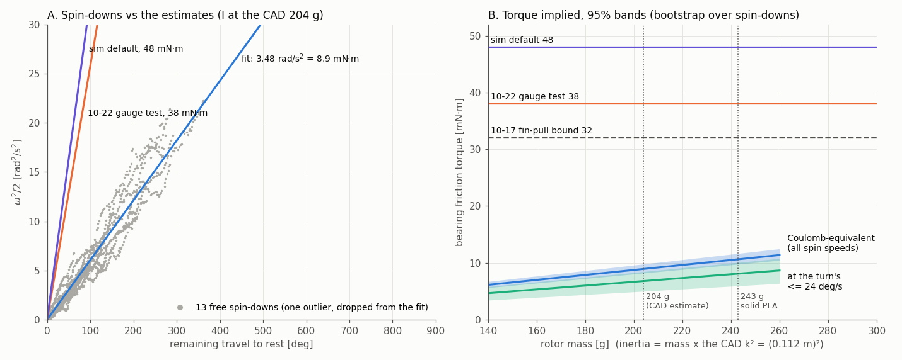

# Valve bearing friction from a free-spin bench test (2026-10-23)

User request: check whether the bearing-friction estimate is accurate, using a mocap recording of the
valve clamped to a table and spun. The beam was sometimes pulled round with a string and sometimes
flicked and left to stop by itself.

Bag: `docs/experimental_data_ros2_bag/1023 - T650-AM whole-body Box-Pushing [Fail, safety]-.../
mocap_valve_spin_20261023_174910`. It holds 133 s of `/vrpn_mocap/obj_0/pose` (120 Hz, raw VRPN)
and `/obj_0/mocap`. The rotor turned 15.5 revolutions in total.



## Result

**The free spin-downs say the bearing's running friction is about 9 mN·m, not the 38 mN·m of the
10-22 gauge test.** The sim's default is 48 mN·m.

| quantity | value (95 %, bootstrap over spin-downs) | torque at the CAD 204 g rotor (I = 0.00257 kg·m²) |
|---|---|---|
| Coulomb-equivalent deceleration (all spin speeds) | 3.48 rad/s² [3.19, 3.81] | **8.9 mN·m [8.2, 9.8]** = 0.056 N at the fin |
| deceleration at the turn's speed (≤ 24 deg/s), Coulomb + viscous | 2.65 rad/s² [1.95, 3.29] | 6.8 mN·m [5.0, 8.5] |
| viscous part | c = 0.30 /s [0.08, 0.61] | b ≈ 0.8 mN·m·s/rad, 0.3 mN·m at the turn's speed |

- **The shape is Coulomb.** ω²/2 against the remaining travel to rest is a straight line through
  the origin (panel A). The viscous part raises the deceleration from 3.1 rad/s² at 115 deg/s to
  4.3 at 344 deg/s. The spin-downs end abruptly with no creep; one shows a 25 deg/s rebound. The
  scene's Coulomb-only model is the right form for the turn's speeds.
- **The deceleration is solid.** The yaw and the marker centroid's circle angle are two
  independent angle measures, and both give 3.48 rad/s². Moving each spin-down's start from 0.12 s
  to 0.25 s after the speed peak changes it by 2 %. One spin-down (81.1 s, 61° of travel) was
  dropped as a > 3 MAD outlier, probably still touched. The −726 deg/s spin at 120.9 s follows the
  string pulls; the segment finder rejected it and it is not used.
- **The torque rests on one number the bag cannot give: the rotor's inertia.** I is the CAD
  inertia scaled to the 204 g mass estimate. Panel B shows the torque for any mass with the CAD
  mass distribution. The 243 g solid-PLA upper bound gives 10.6 mN·m [9.8, 11.7]. **38 mN·m is out
  of reach even for a physically impossible rotor.** With all 243 g at the 0.2 m tip, I would be
  0.0097 kg·m² and the torque would still be at most 37 mN·m. This assumes nothing heavier than
  the mocap markers was fixed to the rotor.
- Spin-to-spin scatter is ±16 % (one standard deviation). The 0.55° tilt of the rotation plane
  (marker-circle fit, toward azimuth −164°) does **not** explain it. A fitted 1/rev gravity term
  lands 100° off the geometric phase, and imposing the geometric term widens the scatter
  (`analysis/tilt_check.txt`). The mean is unaffected either way.
- The mocap angle carries a ±3° error that depends on the rotor's orientation. Yaw and circle
  angle differ by the same pattern on every spin (`analysis/seg_detail.png`). This is why a
  per-spin parametric split of Coulomb and viscous friction (`tools/fit_global.py`) is unstable:
  c ranged from −1.4 to 2.6 per spin. The energy regression in `tools/decel_fit.py` integrates
  over each spin and is immune to it.

## Against the earlier measurements

| test | lever / load on the bearing | result |
|---|---|---|
| 10-17 gauge pulled at the fin, r 0.160 | tangential, ≤ 0.2 N | ≤ 32 mN·m (never past the first division) — **consistent** (9 mN·m = 0.056 N) |
| 10-22 gauge on a rope at the hub, r 0.030 | 1.2-2.6 N, sideways, just above the bearing | ~38 mN·m (26-46) — **4x the free spin** |
| 10-23 free spin-down (this) | rotor weight only | 8.9 mN·m (6.8 at ≤ 24 deg/s) |

The 10-22 number needs 4-9x the force that the free spin implies at that lever. Plausible causes,
**none tested**:
- The side load: 1.2-2.6 N at the hub, against 0.05-0.3 N at the fin for the same torque. It tilts
  the rotor in its single 7 mm-wide 608 and may make the hub or beam rub.
- Rope friction or wrap at the hub.
- Hand-pull dynamics.

If side load raises the friction, the drone matters here too. Its claw puts radial and vertical
loads of several newtons on the fin: K_y × the arm's absorbed wander.

## What it means

- **For the force the claw must deliver, the sim's 0.048 N·m is 5x conservative.** That direction
  was intended.
- **The risk sits on the low side.** Friction damps the contact-phase slosh. The final valve config
  of 10-22 (free-axis anchor 0.75, on_world) has only been flown at 0.048. README 15.8 of
  `valve_turning_20261015` shows older configs completing from 0.005 upward, so ~0.009 is likely
  fine. It has not been shown for the current config.
- Static (breakaway) friction is not in this data: no spin starts from rest without a hand on it.
  It is still bounded only by the 10-17 ≤ 32 mN·m.

Suggested, not done:
1. Weigh the rotor, which pins I to ~10 %.
2. Hang a thread from the fin hole (r 0.160) and lead it off the table edge with a small weight.
   ~5.7 g keeps the beam turning if the friction is 9 mN·m; ~24 g if it is 38. Mocap at two weights
   also gives I and the friction independently, with almost no side load.
3. A few headless valve missions of the final config at `PEGASUS_VALVE_FRICTION=0.009`, labelled as
   a stress case. The scene default stays the user's 0.048.

## Reproduce

Run from this folder. Extraction needs ROS sourced; everything else uses `PYTHONNOUSERSITE=1 /usr/bin/python3 -I`:

```
source /opt/ros/humble/setup.bash && source ~/ros2_ws/install/setup.bash
/usr/bin/python3 tools/extract.py "<bag dir>" spin.npz      # bag -> npz
tools/kin_build.py                                         # angle (yaw + circle angle), rate
tools/stopping.py kin.npz                                  # spin-downs that end at rest -> stopping.npz
tools/decel_fit.py stopping.npz                            # deceleration, bootstrap -> decel_fit.npz
tools/tilt_check.py                                        # the axis-tilt test
tools/figure.py                                            # fig_bearing.png
```

`tools/segments.py` finds the spin-downs: a speed peak ≥ 200 deg/s, fit from 0.12 s after it,
dropped if the speed rises again by 40 deg/s before stopping. `tools/kin.py` holds the
local-polynomial rate. The `.npz` files are gitignored; regenerate them from the bag.
