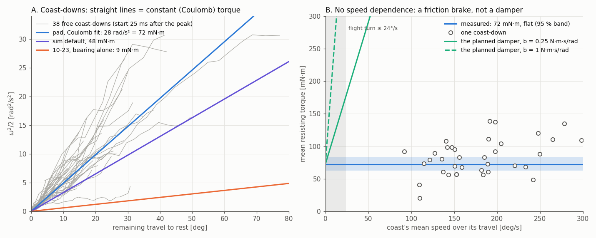

# Valve with the fabric pad on the hub: free-spin bench test (2026-10-27)

User request: read the free-spin mocap bag of the valve after a pad was added. Give the valve torque
now, and say whether this "damper" is good enough for the flight test.

**The change (CAD `Valve_Assembly_v2.stl`):**
- Two new static half-rings around the hub: inner radius 27.2 mm, 20 mm tall.
- The hub's radius is still 25.0 mm, so the gap is 2.2 mm.
- One layer of pad fills the gap. Its contact face is a woven printed fabric: the cloth face of a
  mouse-pad-like mat (user's photo).
- The rotor shell is byte-for-byte the v1 rotor (195.79 cm³), so the rotor inertia is unchanged.

**The bag:** `docs/experimental_data_ros2_bag/1027 - T650-AM whole-body Box-Pushing & Tracking
[Success]-.../mocap_valve_spin_20261027_183950`. It holds 124 s of `/vrpn_mocap/obj_0/pose` at 120 Hz.
The test had about 60 hand flicks and two stretches turned by hand at ~100°/s (82–99 s). The
hand-turned stretches carry no force, so they are not used.



## Result

**The pad is a friction brake, not a damper.**

| quantity | value (95 %, bootstrap over coast-downs) |
|---|---|
| Coulomb-equivalent deceleration | **28 rad/s² [24, 33]**. Two fits × two angle measures × two start delays all give 27–30. |
| torque at the CAD 204 g rotor (I = 0.00257 kg·m²) | **72 mN·m [63, 84]** = 0.45 N at the fin (r 0.160) |
| same at the 243 g solid-PLA upper bound | 86 mN·m |
| viscous part c = b / I | consistent with 0: energy fit 3.2 /s [−0.4, 10], trajectory fit −1.3 [−5.2, 2.8] |
| → damping b | **≤ 0.026 N·m·s/rad** (most permissive bound) |
| coast-to-coast spread | ±33 % (1 σ, includes measurement error) |
| before the pad (10-23, bearing alone) | 9 mN·m. The pad adds ~63 mN·m (8×). |

- **Coulomb, measured two ways.** ω²/2 against the remaining travel is a straight line through the
  origin on every coast (A). Each coast's mean torque does not rise with its speed over 90–300°/s (B).
- **The planned damper was 0.25–1.0 N·m·s/rad.** That would add 0.4–1.5 N·m at 90°/s, and the flicks
  would have stopped in ~10 ms. They took 0.07–0.3 s, linear in time.
- **Direction:** + 29 vs − 36 rad/s² raw. That is not significant once speed is included (−1.3 ± 1.7).
- **No 1/rev torque is resolved.** A gravity or a friction-runout term fits 2–9 rad/s² depending on
  the angle source, and neither predicts a left-out coast better than plain Coulomb (`tools/onerev.py`).

**Angle measure:**
- `tools/angle.py` projects the body axes onto the plane normal to the fitted rotation axis, since the
  body frame sits 2.2° off that axis.
- The rotation-plane tilt from the marker centroid's circle and from the rotation vectors agree to 0.18°.
- The two angle measures agree to ±1° (10-23: ±3°).

## Measured in passing

- **The rotation axis is 2.6° off vertical** (toward world azimuth −17°). On 10-23 it was 0.55°.
- The rotor's CoM sits ~85 mm off the axis (CAD).
- At 2.6° that gives a 1/rev gravity torque of up to ±7.7 mN·m. Level the plate on the flight table.

## Not measured by this test

- **Breakaway (static) friction.** No coast starts from rest. Cloth is often stickier at rest than
  sliding, which would mean stick-slip at the start of the turn.
- **The torque at the turn's speed.** The flight turn is ≤ 24°/s; these coasts averaged 90–300°/s.
  The fits allow ~45–95 mN·m when extrapolated to low speed.
- **The rotor mass.** The torque scales with I, and I is the CAD shape at an estimated 204 g.

**One bench test settles all three:**
1. Lead a thread from the fin hole off the table edge and hang weights on it.
2. The smallest weight that starts the beam gives the breakaway friction.
3. The steady speed at two weights gives the low-speed friction and I.
4. 46 g at r 0.160 balances 72 mN·m.

## Reproduce

Run from this folder. Extraction needs ROS sourced; the rest uses `PYTHONNOUSERSITE=1 /usr/bin/python3 -I`.

```
/usr/bin/python3 tools/extract.py "<bag dir>" spin.npz   # bag -> npz (copied from valve_bearing_spin_20261023)
tools/angle.py spin.npz                                  # rotation angle about the fitted axis, 2 ways
tools/coasts.py th_q 0.025                               # coast-downs + per-coast decelerations
tools/fit.py coasts_th_q_25.npz 200                      # Coulomb / viscous, energy + trajectory, bootstrap
tools/onerev.py coasts_th_q_25.npz                       # is there a 1/rev torque?
tools/figure.py                                          # fig_damper.png
/usr/bin/python3 tools/cad_v2.py                         # the v2 CAD's shells
```

`fit_*.txt` hold the three fit runs (th_q 25 ms, th_c 25 ms, th_q 50 ms). The `.npz` files are
gitignored; regenerate them from the bag.
