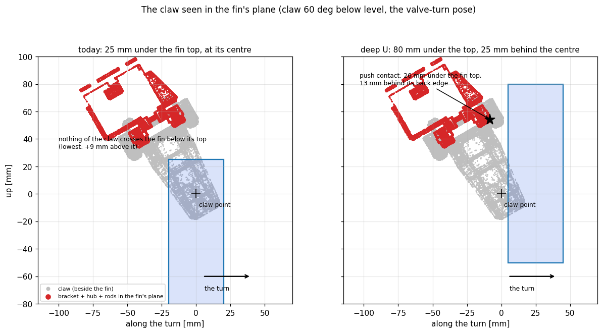

# Valve turning: the U push -- where to hold it, how far to close it (2026-11-02)

User request, after the half-close discussion (`../valve_cup_abort_20261102/`): *"if this direction is correct,
implement the simulation and test its performance, also determining which is the good pose for pushing and some
other details, also how much distance should the gripper close."*

The direction: a gripper that never clamps the fin (a "U"), so the drone is never fixed to the valve, which is bolted
to the table. Everything here is Isaac on the **bare 5 mm fin** (`PEGASUS_VALVE_FIN_GRIP_MM=0`): a U never clamps,
so it does not need the 20 mm invisible grip shim the full close needs, and the shim would fake the contact.

## 1. The half close at today's grasp cannot push the fin

**The claw's CAD** (fsc_open_manipulator's custom arm meshes: `link5` = the bracket with the gripper's hub crank and
rods, and the two claws; the same geometry Isaac's asset was extracted from). In the turn pose [0, 5, 25, 0] the claw
points 60 deg below level along the turn. With the jaws off the fin's faces, only material that crosses the fin's
mid-plane can push the fin along the turn, and that is the bracket between the claws. At today's grasp (the claw
point 25 mm under the fin top, at its centre) the lowest such material is **9 mm above the fin top**: the claw slides
along the fin without touching it (`figures/grasp_today_vs_deep.png`, left).

**Isaac, f0** (today's half close, Isaac 0.012, at today's grasp): the valve turned **19 deg of 90**. The right claw
touched the fin's top edge for ~1 s, then -- with the fin ~70 deg behind the plan -- the **landing gear** ran into the
fin's top-back corner and pushed it (the contact log names `/body`). A U that loses the fin leaves it behind the
vehicle, and the vehicle then flies into it: any U design needs a guard on the valve's lag.

The morning's half-close turns (84-92 deg) were pushed through the pads on the 20 mm shim, which left the U only a
few mm a side: a light clamp, not a U.

## 2. Where to hold the U (`tools/grasp_search.py`, `tools/push_geom_screen.py`)

On the CAD, for each grasp depth d (the claw point d under the fin top) and shift s (the claw point s behind the
fin's centre along the turn): the first bracket point the fin's back edge meets when the claw moves forward (the
**push contact**: how far under the fin top, after how much **slack**), and the clearance on the Ready slide
(from 0.12 m behind, 0.10 m above).

- The push surface is **the bracket's front corner** (link5 x 20, z 57 mm: the face toward the claws, at its
  forward-up edge), ~54 mm above and ~8 mm behind the claw point. Against the fin's vertical back edge this is an
  edge-on-edge contact whose normal is horizontal along the turn: in Isaac the hub pushed the fin 0.98 along the
  turn, with almost no vertical component.
- Deeper puts that corner further under the fin top; further behind keeps it clear of the fin on the slide-in, and
  the clearance equals the slack (8 mm at s = 20, 13 mm at s = 25).
- **Chosen: d = 80 mm, s = 25 mm**: the contact 20-28 mm under the fin top, 13 mm of slack (= ~5 deg of turn),
  13 mm of clearance on the slide-in. (d = 70 / s = 20: 14-20 mm under the top, 8 mm slack and clearance.)
- **The pose stays [0, 5, 25, 0].** A flatter claw (40-50 deg below level) has a better bracket too, but at these
  depths it puts the landing gear within 1-2 cm of the beam (the 2026-10-15 gear constraint); at 60 deg and
  d = 80 the gear stays ~84 mm above the beam top.

## 3. Isaac: depth and jaw opening (chains 1-2, nominal, 90 deg in 18 s, bare fin)

| run | grasp (under the top / behind the centre) | jaws | outcome | valve turned | max lag | tilt max | what pushed the fin | contact under the top |
|---|---|---|---|---|---|---|---|---|
| f0 | 25 / 0 mm | half close (0.012) | complete | **18.7 deg** | 84 deg | 2.2 deg | a claw's top edge, then the **landing gear** | at the top |
| f1 | 45 / 0 | half close | complete | 85.1 | 8.2 | 2.5 | hub + rod, 0.98 / 0.94 along the turn | 0-7 mm |
| f2 | 80 / 25 | half close | complete | 85.2 | 9.7 | 2.5 | hub (oblique) + one claw's inner edge | 25-27 mm |
| f3 | 80 / 25 | **open** | turn flown (the driver's artifact aborted after it) | 85.8 | -- | 3.3 | **the hub alone**, 0.98 along the turn | 24-28 mm |
| f4 | 80 / 25 | closed (-0.010) | **aborted before the turn**: tilt guard 10.8 deg | -- | -- | 5.9 | the claws' rear rails CLAMPED the fin, 10-12 N | -- |
| f5 | 70 / 20 | half close | complete | **90.9** | 7.0 | 2.4 | hub, 0.98 along the turn | 14-20 mm |

- The deeper grasp is what makes the U push. At 80 mm the contact sits ~25 mm under the fin top, so a few mm of
  height error cannot make it ride over.
- **How far to close: not at all.** At the deep grasp the fin sits next to the claws' rear rails, the narrowest
  part of the U (Isaac: 4.8 mm from each face of the fin with the jaws open). Closing even part-way puts a claw on
  the fin (f2: an oblique wedge), and the full close clamps it with 10-12 N (f4). With the jaws **open**, the hub
  alone pushes, cleanly along the turn (f3).
- The ~13 mm of slack costs ~5 deg: plan 95 deg for a 90 deg valve turn (or 20 mm behind, 8 mm slack, 90 deg).

## 4. Robustness, aborts, the governor (chains 3-5, the deep U with the jaws OPEN)

Chain 3 first exposed two artifacts of this campaign's TEST DRIVER with a U that stays open: it waited
for the jaws to move at the close and at the exit (h1: the turn flew, 89.6 deg, then the driver aborted
the exit). Both fixed in `tools/driver/pl_mission.py` (a copy; the planner flying the step is the event too).

**The shipped approach gates, under the hardware-like drift** (`PEGASUS_PLANT_FORCE_NOISE=0.32,0.12,k`):
both runs aborted safely BEFORE any contact -- h2: Ready never started (the "claw still" gate, 30 mm/s);
h3: the claw did not settle within 6 s (the station aborted, the drone kept DIRECT). That is the approach
the valve took from the box push this morning, not the U. To test the U's CONTACT phase under drift, the
drift runs below relax those gates (Ready under 60 mm/s, the hand-over within 35 mm / 50 mm/s, the
station's gate 8 mm across and 12 s to settle). **The shipped gates were not changed.**

| run | what | outcome | valve turned | max lag | tilt max | q3 min |
|---|---|---|---|---|---|---|
| k1 | nominal, planned 95 deg | complete (incl. the exit) | 93.5 | 9.0 | 2.4 | 20.6 |
| k2 | drift seed 2 | complete | 91.7 | 10.5 | 3.2 | 13.5 |
| k3 | drift seed 3 | complete | **79.6** | 21.5 | 3.2 | 15.7 |
| k4 | drift seed 4 | aborted before the turn (approach gates), safe | -- | -- | 2.3 | -- |
| k5 | the operator's ABORT 10 s into the turn | jaws already open -> **climb at once**: +60 mm at 1 s, DIRECT kept | 37 then stop | -- | 3.6 | 22.2 |
| k6 | a guard abort (q3 floor raised to 22 deg) | tripped only in the exit (q3 never under 22 in the turn); climb at once, DIRECT kept | 89.4 | 7.8 | 3.3 | 22.3 |
| k7 | + the path-following governor (lead [10, 20] deg) | complete, the governor never acted | 94.1 | 9.7 | 2.1 | 22.6 |
| k8 | the governor, on the SHALLOW grasp (the U cannot push) | the turn HELD at a 34 deg lag, aborted after 6 s; **nothing touched** (f0 without it: the landing gear hit the fin) | 0 | 34 | 2.3 | 22.2 |
| k9 | 70 mm under / 20 mm behind, planned 90 | complete | 91.4 | 6.4 | 2.4 | 20.1 |

k3 is the U's weak spot: it only pushes. Under drift the vehicle fell behind, the bracket left the fin, and the
plan ended 15 deg ahead of the valve. The governor answers exactly that (it holds the plan while the valve lags).

**The final configuration (chain 5)**: 80 mm under / 25 mm behind, jaws OPEN, planned 93 deg, the exit room-held
0.12 m, the governor on (lead [10, 20]); the drift runs with the relaxed approach gates:

| run | what | outcome | valve turned | max lag | tilt max | q3 min | contact p95 |
|---|---|---|---|---|---|---|---|
| m1 | nominal | complete | 88.4 | 9.1 | 2.2 | 22.1 | 0.65 N |
| m2 | nominal | complete | 89.6 | 9.6 | 2.4 | 21.4 | 0.65 N |
| m2_drift2 | drift seed 2 | complete | 89.6 | 10.3 | 3.0 | 19.8 | 0.63 N |
| m3_drift3 | drift seed 3 | complete | 85.5 | 12.0 | 3.4 | 18.6 | 0.72 N |
| m4_drift4 | drift seed 4 | complete | 95.1 | 8.8 | 3.4 | 16.5 | 0.63 N |

**5 of 5**, the valve at 85.5-95.1 deg (mean 89.6) for a 90 deg target. In every one the bracket (Isaac's `/hub`)
did the pushing, 0.93-0.99 of its force along the turn, 23-31 mm under the fin top; the claws only brushed the
fin's faces; the landing gear never touched it; no joint reached a stop (q3 >= 16.5 deg, its guard 3 deg).

**The implementation, end to end (chain 6, n1)**: the GENERATED valve yaml and the station's NEW default, no
overrides at all -- complete, the valve 88.8 deg (planned 93), max lag 8.3 deg, tilt 3.0 deg, q3 >= 22.7 deg,
contact p95 0.58 N, the bracket pushing 1.00 along the turn 25 mm under the fin top; the station logged
`the jaws stay OPEN on the fin (push_pull_valve_cup_position 0.0190 = the open position) -- the U push`.

## 5. What changed

- **Pegasus**: the valve scene's **contact point log** (`PEGASUS_VALVE_CONTACT_LOG` = a CSV file,
  `_EVERY` steps; off by default; the valve wrapper forwards both) -- every vehicle-valve contact point with
  the link that touched it, which is how the push surface was found. The valve generator
  (`../valve_turning_20261015/tools/make_valve_turning_yaml.py`): `GRASP_BELOW_TOP` 0.025 -> **0.080**, new
  `GRASP_BEHIND_CENTRE` **0.025** (`push_pull_ee_offset` [0.160, 0.0006, 0.179] -> **[0.160, -0.0244, 0.124]**),
  `push_pull_turn_deg` 90 -> **93**, `push_pull_follow` false -> **true** with `push_pull_follow_lead_deg`
  [6, 12] -> **[10, 20]**, `push_pull_exit_world_held_dz` 0.06 -> **0.12**. The hardware generator inherits them
  (its note on the grasp updated). Both valve yamls regenerated, `--check` UP TO DATE; the generated sim yaml
  is value-identical to the one m1 flew. The box profile is untouched.
- **fsc_open_manipulator** (`utils_custom_ground_station`, Valve Turning tab): the default
  `push_pull_valve_cup_position` is now **the open position** (`gripper_open`, 0.019) on hardware and in Isaac
  (was 0.0 / 0.012): the "close" on the fin moves nothing, an abort finds the jaws open. A value below it still
  gives the half close. Startup line: `Valve Turning: the jaws stay OPEN on the fin ... the U push`.
  Harness `tools/gs_upush_check.sh` (valve_cup_abort's, with the half-close cases set explicitly and new
  U1-U3): **PASS**.
- **fsc_autopilot_ros2** (the raw hardware stack): the valve profile expects the new values -- **98 of 98
  present** on a dry run (was 95), box 62 of 62 unchanged -- and its banner says the turn is planned 93 deg
  and names the U push. No planner, law or node code changed.

## 6. For the hardware

- **Bench-check the real claw at the new grasp before flying** (the CAD is the real claw, but the real
  gripper's hub/rods sit wherever its crank is): jaws open, the claw point 80 mm under the fin top and 25 mm
  behind its centre (on the side the drone comes from) -- the bracket's front corner should be ~13 mm behind
  the fin's back edge, ~20-28 mm under its top, and BOTH claws (their rear rails included) clear of the fin's
  faces. Slide the claw along the turn by hand: the bracket corner should meet the back edge squarely.
- **The gripper**: open. If the rails touch the fin on the bench, the claw is too far toward one side
  (radially), not too closed. Do not half-close at this depth (f2: a claw wedged the fin; f4: the full close
  clamped it).
- **The approach gates** are the ones flown on the box push (10-27); under Isaac's drift model they abort
  before contact (safe). If Ready keeps waiting on hardware, the vehicle is not calm enough for it.
- This afternoon's deploy prompts (`../valve_cup_abort_20261102/deploy_*_prompt.md`) describe the half close
  at the old grasp, which cannot push the fin: **superseded** -- regenerate them with the commit.

## 7. Follow-ups, 2026-11-03

- **The abort climbs once** (user: *"it climbs twice, one short and another higher ... can we directly abort
  higher? and then fold the arm to the home pose"*). The abort was two rest-to-rest legs, 60 mm in 0.8 s
  (`push_pull_abort_fast_climb`, added for the half close) and then the rest of the 0.30 m, so the U push's
  claw, 80 mm under the fin top, stopped ~20 mm under it, beside the fin, following the vehicle. Now
  `push_pull_abort_climb` 0.30 = `push_pull_abort_fast_climb` 0.30 in `_fast_climb_s` 1.5: one leg (the planner
  already treats a fast leg as tall as the climb as the climb), then the arm folds home (6.5 s). The user then
  asked that the abort run *"immediately without any waiting time / hesitation"*: a first 2.5 s version started
  too gently (10 mm only at 0.5 s), so 1.5 s -- 10 mm at 0.31 s (the old fast leg 0.27), the claw past 80 mm at
  0.59 s, 0.30 m at 1.5 s, peak 0.44 m/s / 1.0 m/s^2 (the old leg 0.70). The old climb took 4.3 s to the same
  height. Nothing in the chain waits: in k5 / k6 the reference rose 0.09-0.16 s after the trigger, the abort plan
  is ready in < 10 ms, the station's ABORT opens the jaws and calls the planner together, and the planner's hold
  for the jaws to read open never holds in the U push (they are open whenever the claw is on the handle). Generator only;
  both valve yamls regenerated (`--check` UP TO DATE); the raw hardware stack expects the three values (valve
  99 of 99, box 62 of 62); new gtest `PushPull.AbortWholeFastClimbIsOneClimb` (push-pull suite 30 of 30).
  Not flown in Isaac.
- **The landing gear vs the valve** (`tools/gear_marker_clearance.py n1_generated.npz`: AM_T650's gear mesh, the
  points more than 0.20 m under the body origin, placed with n1's TRUE body pose; the valve's marker balls and beam
  with obj_0's pose). The gear is never over the beam: the skid tips stay 17-60 mm short of it horizontally
  (closest 8-10 s into the turn). Its lowest point is 73-87 mm above the beam top's height (78 at the hold); the
  real T650's gear is measured 5.5 mm deeper (0.248 vs 0.2425), so ~67-81 mm. The closest part of the valve is
  the tallest marker ball (#2, top 140 mm above the plate, by the hub): 33 mm (hardware ~28). Nothing touched.
  The fin runs between the skids, ~0.14 m from each -- the asset's spacing (X650's frame, only the gear
  shortened): measure the real T650's.

## 8. Not done

- Isaac's claw collides through convex decompositions of the bracket, hub and rods; the CAD screen and the
  Isaac contact heights agree (CAD 20-28 mm under the top, Isaac 23-31), but the real part decides.
- No hardware flight; no run of the governor + the SHIPPED approach gates under drift (they abort first).
- The approach gates themselves (a separate question from the U).
