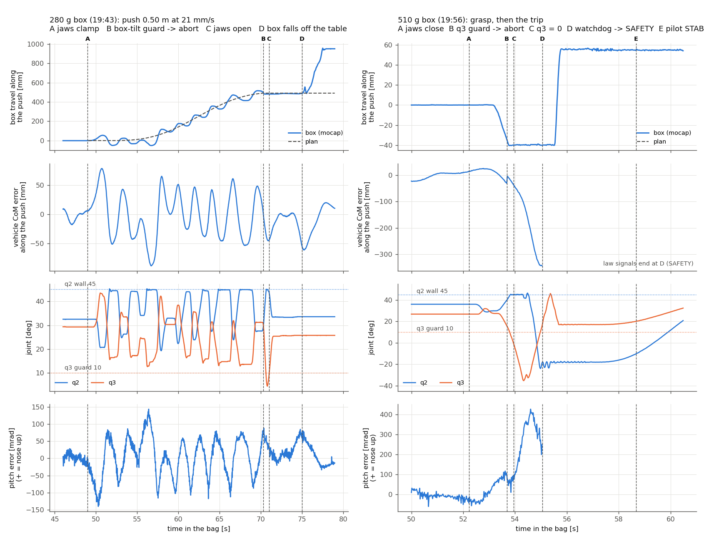

# 2026-10-24 evening box pushing on hardware: the 280 g push and the 510 g failure

Bags: `docs/experimental_data_ros2_bag/1024 - T650-AM whole-body Box-Pushing-.../`
`flight_wb_l1_4d_box_pushing_280g_20261024_194310` (the push) and `..._500g_20261024_195657`
(the failure). Whole-body 4-D L1, raw mocap, the hardware box yaml as pushed on 10-24 evening
(`fe5bc49`: hand-over settle + calm exit, q2-aware q3 guard at 10 deg, free-axis anchor 0.75 on
the room hold, K_y 120, k_R/k_w 1.6/1.2, omega_c_t 1.0), push at 21 mm/s.

**Box mass correction (user, 2026-10-25): the box is 280 g, always.** Every earlier hardware push
recorded as "240 g" (10-21, 10-23, 10-24 morning and afternoon) was 280 g. The second flight's box
was 510 g (the bag name says 500 g).



## 1. The 280 g push: why it goes back and forth

| | |
|---|---|
| push | 0.50 m planned in 23.8 s (+ 1.5 s clamped hold); box at **495 mm** when aborted, the plan said 493 |
| ended by | the **box-tilt guard** at 70.31 s (2.9 deg > 2.0), 4 s before the end |
| box speed in the slide | mean 23 mm/s (plan 21), **std 84 mm/s, range -180..+295** |
| box moving backward | **41 %** of the slide; **17 direction reversals** in 19.6 s |
| vehicle CoM error along the push | 39 mm rms, 167 mm p-p, one peak at **0.47 Hz** (2.1 s period) |
| true vehicle tilt (mocap), 0.05-1 Hz | **2.1 deg along / 1.8 deg across** in contact vs **0.3 / 0.3** in the hover just before |
| arm | q2 19-45 deg (on its 45 deg wall 21 % of the time), q3 13-44 deg (< 15 deg 19 % of the time) |
| guards near their limits | force reading 4.5 of 5.0 N; box lag 28 of 40 mm |

**What the back-and-forth is.** The vehicle itself oscillates along the push (and across it) at
0.47 Hz from the moment the jaws clamp the fin. The free-axis anchor (10-21/22, kept because without
it the clamped arm buckles) moves the claw's target by 75 % of the vehicle's along-push error, so the
clamped box is carried with the vehicle: forward 50 mm, back 50 mm, every 2 s, on top of the 21 mm/s
plan. The plan is smooth; the box follows the vehicle.

**It starts at the clamp.** In the 1.5 s clamped hold before the slide, a nose-down pitch moment of
about 0.4 N.m appears in the observer's deadbeat residual. The filtered rotational estimate
(omega_c_r 0.74 rad/s) learns it in ~1.5 s. Meanwhile the vehicle pitches 126 mrad (7 deg) and runs
79 mm forward (T e_R / k_x = 36.4 N x 0.126 / 50 = 92 mm), pushing the box 55 mm before the slide
begins. The oscillation never settles after that.

**Ruled out, from the flight data:**
- PX4's attitude estimate: it tracks the mocap to 0.18-0.20 deg rms (0.12 N of misdirected thrust).
  The vehicle REALLY tilts 2 deg; the law commands it. (Not the 10-22 wander mechanism.)
- Rotor saturation: no rotor at a limit; single-tick allocator saturation only.
- The arm's torque delivery: applied - commanded = the -0.08 N.m gravity correction, nothing else.
- Battery: 23.7 V at the push.

**It is in every hardware push so far** (true tilt in contact vs the open-jaw hold before it):
10-21 (no free-axis anchor) 1.1 / 1.7 vs 0.5 / 0.7 deg; 10-24 A 1.9 / 1.4 vs 0.3 / 0.0; tonight 2.1 / 1.8
vs 0.3 / 0.3.

**Not resolved: what amplifies it.** The offline exact-law bench (`tools/box_bench.py`: the 10-22
bench + a clamped box with Coulomb friction, a stiff table, an optional clamp moment, and hardware-level
noise on the contact force reading) does NOT reproduce it: the box adds little to the vehicle's wander
there, and its transfer at 0.47 Hz differs (pitch/CoM 0.95-1.17 rad/m at -125..-130 deg vs the flight's
1.47 at -101). Neither a clamp moment (k_c 3-12 N.m/rad) nor box friction amplifies it in the bench.
Candidates the bench models only partly: the box/fin/pad compliance and stick-slip, the arm's joint
friction, and the contact-only force feedback (below).

**The contact-only force feedback.** With the contact flag on (chi = 0) the 4-D reading F_hat_y is fed
into u3 through (Lambda_y M_y^-1 - I); along the nose Lambda_y = 1.70 kg vs M_y = 1, so +0.70 x F_hat_y
reaches the arm. On hardware that reading is 0.96-1.50 N rms along the nose in contact (the box needs
~0.7 N to slide; before the clamp it is exactly 0). In the bench, hardware-level noise on it raises the
wander (CoM 14-29 -> 21-34 mm rms, more time on q2's wall), and the contact flag off brings it back.

### Optimisation options (none applied)

| option | evidence | cost |
|---|---|---|
| hardware A/B: `push_pull_contact: false` (no F_hat_y rendering in u3) | removes a contact-only 1-1.5 N rms force path; bench: modest | changes what the push demonstrates (no contact attribution in u3); the trim then learns the box force |
| `wb_k_r` 1.6 -> 2.134 (H1b, flown on hardware in free flight) | 25 % less tilt per contact moment; bench: fewer q3 trips | the 1.5 Hz pitch mode with a payload (10-02, Isaac); needs a box run first |
| shorter push for the showcase (0.25-0.30 m) | fewer cycles; the tilt guard tripped 21 s into contact | less to show |
| faster push | NOT recommended: the box's speed swings +-60 mm/s; 30 mm/s does not stop the reversals in the bench, and the box's friction (and tipping) rises with speed | |
| free-axis anchor off or 0.4 | NOT recommended: the bench buckles 3/3 (w 0) and 2/3 (w 0.4) after the hand-over | |

## 2. The 280 g abort knocked the box off the table

- **70.3-70.8 s, a near-miss:** the abort began during a backward swing. With the jaws still closed
  (open at 70.9 s), q3 fell 30 -> **4.5 deg** at ~60 deg/s with q2 on its 45 deg wall. The light box slid
  back with the claw and the jaws opened in time. The same stretch as the 510 g failure (section 3).
- **70.3-74.8 s:** the abort kept the OPEN claw at fin height for 4.5 s (1.5 s release wait + a 3.0 s
  "back 0.03 m" leg). The vehicle still drifted 30-50 mm; at 73.75 s a jaw pushed the fin; the box
  tilted 1.8 -> 6.3 deg, then **tipped over the table's side at 75.0-75.25 s** and slid ~1 m on the
  floor (mocap: x 1.55, z 0.10). It was back on the table by 100 s.
- The valve-turning safety pass (10-18) found the same: backing out at handle height drags the open pads
  along the handle; the valve yaml ships `push_pull_abort_back: 0` (straight climb).

## 3. The 510 g failure, second by second

| t [s] | event |
|---|---|
| 50.38 | Ready ends 26 mm from the grasp point, swinging (up to 58 mm/s); hand-over after 1.84 s |
| 52.22-52.7 | jaws close on the fin |
| 52.8-53.6 | the vehicle pitches **nose-up to +114 mrad** and backs off; the box is dragged 40 mm back (box tilt 0.3 -> 2.9-3.6 deg) |
| 53.0-53.62 | box-tilt reading above 2 deg most of the time; its 0.2 s persistence is reset by single samples under 2 deg |
| **53.68** | **the planner's q3 rate guard** (q2-aware): q3 16.2 deg falling 45 deg/s -> 8.4 deg in 0.2 s; q2 39.7 rising -> push-and-pull ABORT, the GS opens the jaws |
| 53.8 | q2 on its 45 deg wall: the arm is straight and cannot hold the box any more |
| **53.95** | **q3 crosses 0** (0.27 s after the trip), the elbow-singular branch; jaws open by ~54.2 |
| 54.0-55.0 | j2/j3 at the 3.0 N.m law clamp; q3 to -34 deg; **q2 whips 45 -> -23 deg**; pitch error 0.43 rad |
| **55.05** | **the node's DIRECT watchdog**: tilt 15.2 > 15.0 deg -> SAFETY; arm on the PD hold at q2 -18 (hanging down) |
| 55.4-55.9 | the vehicle swings back over the table end; the hanging claw sweeps 200 mm sideways at box-top height and **knocks the box ~95 mm** |
| 55.0-58.7 | SAFETY sinks **0.27 m** (1.24 -> 0.97 m): collective 0.591 vs DIRECT's 0.612, its UDE re-learns -1.4 -> -2.7 N; the arm folds home from 57.06 over 5.8 s |
| 57.8-57.9 | a skid's front end crosses the table's end at table-top height (+5 / -9 mm in my geometry; skids modelled +-0.15 m long, +-1-2 cm): touching or within ~1 cm. No jolt in the attitude |
| 56.7-58.7 | the hanging claw 2-15 cm **below** the table top, 8-13 cm from its edge; rotor hubs 16-17 cm above the top while a prop disc overlaps it |
| 58.66 / 60.83 | pilot takes STAB / disarms |

**Guards that fired:** the q3 rate guard (first, correctly), the node's 15 deg tilt watchdog, the GS's
"left DIRECT on the handle -> open". **Did not fire:** the box-tilt guard (by a hair: a full-rate replay
of the same rule trips at 53.21 s, 0.47 s earlier), the force guard (1.3 of 5 N), the planner's 10 deg
tilt guard (the true tilt was 5 deg until the abort; after it the planner was already aborting and the
node's 15 deg watchdog acted).

**Why the guard could not save it.** A posture guard fires ~0.3 s before the arm passes the
singularity in a fast fold. The jaws need ~0.5 s to open, and the abort holds the vehicle's MEASURED
pose, taken mid-lurch, so the vehicle keeps backing away while the clamped box anchors the claw. The
280 g abort had exactly this in its first 0.5 s and missed by 4.5 deg. A heavier box resists more
(510 g: ~1.25 N of friction vs ~0.69 N) and holds the claw while the arm straightens.

Battery: the 510 g flight took off at 23.35 V and was at 22.94 V at the grasp (CW rotor pair at 0.71).

## 4. Guard and abort improvements (none applied)

| # | change | where | evidence |
|---|---|---|---|
| G1 | abort: climb straight up once the jaws are open (`push_pull_abort_back` 0.03 -> 0); optionally release wait 1.5 -> 1.0 s (the jaws opened 0.52 s / 0.6-0.7 s after the trip on the two flights) | config, box yaml generator; Isaac check first | the 280 g box was knocked off during the 3 s back leg; valve 10-18 |
| G2 | SAFETY thrust map matched to the flown kf 4.260431e-05: 0.037947 / 0.252449 (now the bench-kf 0.036758 / 0.241528) | config, hardware yaml; verify with a free-air revert | the 0.27 m sink next to the table; the known 0.2 m revert dip |
| G3 | abort after a STRETCH trip: put the claw on the CoM anchor in ~0.2 s (now 1.0 s), and hold the vehicle where the arm is at its push pose relative to the claw, not the mid-lurch measured pose | code (planner + node) | both aborts tonight stretched the arm in their first 0.5 s |
| G4 | box-tilt guard on a low-passed tilt (0.1 s) at 2.0 deg / 0.2 s, so one sample cannot reset it | code (planner) | replay: 510 g trips at 53.21 (0.47 s earlier). The replay sits within ~0.05 deg of the planner's own reading (it misses the 280 g trip at 70.3 that the flight made), so read this as "filter the tilt", not a tuned number |
| G5 | a SAFETY revert from contact re-seeds the reference higher (e.g. +0.3 m) | code (node, box profile) | the vehicle drifted back over the table end, sinking, with the arm hanging |

## 5. Is 500 g safe?

No, not with the present controller and abort. The failure happened on the first 510 g attempt, at the
grasp, before any push. The same stretch reached q3 4.5 deg in the 280 g abort. None of G1-G5 removes the
contact-time lurch that starts it; they shorten the response and contain the aftermath. Showcase the
280 g box, with G1 and G2, a fresh pack per push (>= 24 V), and the pilot ready on the RC.

## Tools

```bash
bash tools/run_extract.sh                                   # both bags -> npz/ (the 10-21 extractor)
cd tools
/usr/bin/python3 timeline.py 194310 195657 > ../timeline.txt
/usr/bin/python3 push_series.py 194310 44 80 > ../push_table_194310.txt   # 50 Hz push window -> npz/push_<tag>.npz
/usr/bin/python3 moment_fit.py 194310 50.6 70.2 0.28         # box speed stats, pitch moment vs box force
/usr/bin/python3 phase_lock.py 194310 51.0 70.0              # lock-in of every driver at the 0.47 Hz cycle
/usr/bin/python3 att_est_error.py 194310 "push:49:70.2"      # PX4 attitude vs mocap; the true tilt
/usr/bin/python3 clamp_coupling.py 194310 45 48.3 49.0 70.2  # does the box tilt with the vehicle?
/usr/bin/python3 claw_box.py 194310 70.0 75.3                # the claw against the box (FK)
/usr/bin/python3 table_clearance.py 195657 52 61 0.1         # skids / rotor hubs / claw vs the table top
/usr/bin/python3 box_tilt_replay.py 195657 50.4 50.4 53.68   # the box-tilt guard replayed at full rate
PYTHONNOUSERSITE=1 /usr/bin/python3 fig_flights.py           # ../fig_flights.png
JOBS=14 /usr/bin/python3 box_bench.py                        # CASES=A1,K6,N1,... the offline clamped-box bench
```
`bp_common.py` loads this folder's npz first, then the 10-24, 10-23 and 10-21 folders'. Bench outputs:
`box_bench_round2.txt` (staged grasp), `box_bench_clamp.txt`, `box_bench_fynoise.txt`
(`box_bench_round1.txt` is the first, unstaged version: its early aborts are a start-up artifact).

## 6. Improving the 280 g push (2026-10-25, user: 280 g only, push ~0.40 m)

**Neither simulator reproduces the hardware oscillation**, so fixes must be judged on hardware.
- Isaac, the shipped config with the hardware-like drift (`box_pushing_settle_gate_20261024/runs/sg*`,
  `tools/isaac_contact_tilt.py`): clamped tilt 0.4-1.0 deg vs 2.1 / 1.8 on hardware, box speed std
  19-27 vs 84 mm/s, backward 6-21 % vs 41 %, q2 never on its 45 deg wall (hardware 21 %).
- The exact-law bench (section 1) does not either.
- Use Isaac only as a regression check for a change (it still completes, nothing new breaks), not to
  rank changes.

**The hardware arm stick-slips in contact** (`tools/arm_stickslip.py`):

| | q2 stuck | q3 stuck | fast slips (> 20 deg/s) | peak speed | q2 on its wall |
|---|---|---|---|---|---|
| 280 g push, 49-70 s | 41 % | 35 % | 17 / 19 | 77 deg/s | 21 % |
| open-jaw hold, 45-48 s | 100 % | 100 % | 0 | 1 deg/s | 0 % |
| 10-24 A push | 63 % | 65 % | 5 / 4 | 61 deg/s | 1 % |
| Isaac sg runs | 17-55 % | 16-57 % | 0-6 | 17-44 deg/s | 0 % |

j2 and j3 rotate about the pitch axis, so friction at a stuck joint reacts on the base as a pitch moment
the law does not model. With the contact flag on, the stuck joints' residual is also read as a contact
force and fed back into u3. Plausible, NOT proven: the deadbeat pitch moment is too noisy to attribute
(R^2 0.08-0.22 for the box force, the joints' slip direction, or both; `tools/moment_sources.py`).

**Plan, one change at a time, two repeats each, scored with this folder's tools** (true tilt in contact,
box speed std, backward share, q2-wall time, q3 minimum, guard margins):
1. Before the next flight (fixes, not tuning): `push_pull_abort_back` 0 (straight climb), the matched
   SAFETY thrust map, a fresh pack (>= 24 V), Push Distance 0.40 typed in the GS (19 s instead of 24 s).
2. Push pose [0, 30, 30, 0] (same 60 deg fold; the claw moves 3.4 mm back and 3 mm down). On the
   flown swing it would be q2 17-43 (off its 45 deg wall) and q3 15-46 (further from the 10 deg guard).
3. `push_pull_contact: false`. This removes the contact-only feedback path, but it changes what the push
   demonstrates: the joint-row trim then learns the box force over ~5 s.
4. `wb_k_r` / `wb_k_w` 2.134 / 1.567 (H1b, flown on hardware in free flight): 25 % less pitch per unit
   moment.

Not recommended: a faster push, the free-axis anchor off, a faster rotational observer.

**Outcome (2026-10-25, `../box_pushing_pose_gain_20261025/README.md`):**
- Adopted: push pose [0, 28, 32, 0] (Isaac 2/2, q3 26.7-44.2 vs 14.2-40.2; [22, 34] 1/2) and the matched
  SAFETY thrust map (hardware box yaml).
- NOT adopted: H1b gains (one 1.6 Hz tilt-guard abort before contact, one 5 s swinging settle, in two runs).
- `push_pull_contact: false`: explained, not tried. `push_pull_abort_back` 0: explained, waiting on the user.
