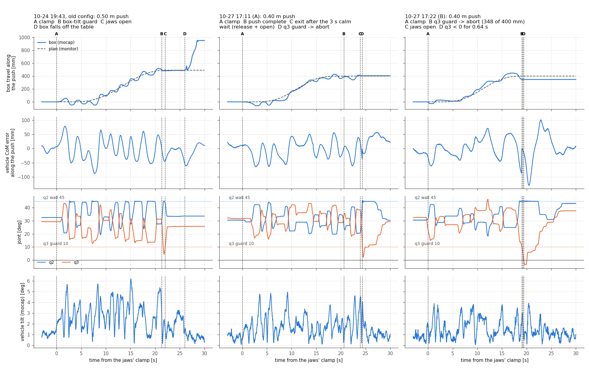

# 2026-10-27 hardware box pushing: the 10-25 configuration flown

Bags: `docs/experimental_data_ros2_bag/1027 - T650-AM whole-body Box-Pushing & Tracking [Success]-.../`
`flight_wb_l1_4d_box_pushing_300g_20261027_171114` (**A**) and `..._172227` (**B**). The folder name
says 300 g and the .db3 500 g; the box is the 280 g box. Whole-body 4-D L1, raw mocap, 0.40 m push at
21 mm/s (19.05 s + 1.5 s clamped hold), the station running every step.

Configuration flown = fsc_autopilot_ros2 `a316625` (10-25) on top of `fe5bc49` (10-24 evening):
push pose [0, 28, 32, 0] (confirmed in the bag: the planner's hold captures and abort messages),
push axis at natural inertia (`wb_my_y` 1.64, `wb_ky_y` 196.8, `wb_dy_y` 33.128 -- same yaml, not
readable from the bag), `push_pull_abort_back` 0 (straight climb), SAFETY map 0.037947 / 0.252449;
from 10-24: the hand-over settle gate and the calm exit.



## 1. What happened

| | A (17:11) | B (17:22) |
|---|---|---|
| hand-over | settled 8 mm / 6 mm across in 0.4 s, jaws closed first try | 19 mm / 3.7 mm across in 0.4 s, first try |
| push | **complete**: box 387 mm at the push end (plan 400), mean 21.0 mm/s | **aborted 1.5 s before the end** at 348 mm |
| ended by | push DONE 67.84 s; the calm exit waited its full 3 s ("NOT calm within 3.0 s, 56 mm/s"), released + opened at 71.13; **q3 rate guard at 71.57** with the jaws already 11 mm open | **q3 static guard at 71.65** (q3 10.5 falling 21 deg/s, q2 44.8 on its wall), jaws closed |
| arm after the trip | q3 min 2.1 deg (never below 0) | **q3 below 0 for 0.64 s, min -3.8 deg**, q2 on its wall |
| box after the trip | moved 0.5 mm, upright, on the table (405 mm) | moved 2.4 mm, upright, on the table (348 mm) |
| vehicle | DIRECT kept, tilt <= 4.6 deg, climbed 0.30 m straight, way home + landing normal | same, tilt <= 3.9 deg |

**Both trips are the vehicle's along-push swing, not a new failure.** A: during the 3 s calm wait the
clamped vehicle kept swinging (-193..+191 mm/s; the box was dragged back 70 mm and forward again); the
exit started at the timeout while the vehicle was moving back at 190 mm/s, and over the 1 s CoM-anchor
blend the arm absorbed ~70 mm of it. B: the box ran ~50 mm ahead of the plan, then the vehicle swung
back 140 mm at up to 174 mm/s, dragging the clamped box 100 mm back onto q2's wall. After B's trip the
abort holds the MEASURED (mid-swing) pose and the vehicle went on 120 mm past it while the claw blended
to the CoM over 1 s: q3 crossed 0. That is the 10-24 evening "G3" item (fast CoM anchor / no mid-swing
hold on a stretch abort), still not applied.

## 2. The modifications

| | 10-24 19:43 (old) | 10-27 A | 10-27 B |
|---|---|---|---|
| box speed in the slide: std / range [mm/s] | 84 / -180..295 | 53 / -110..175 | 45 / -120..135 |
| box moving backward / reversals | 41 % / 17 in 19.6 s | 27 % / 11 in 19.0 s | 18 % / 5 in 17.4 s |
| vehicle CoM error along: rms / p-p [mm] | 39 / 167 | 32 / 121 | 32 / 157 |
| TRUE tilt 0.05-1 Hz along / across [deg] (hover before: ~0.2-0.3) | 2.1 / 1.9 | 1.5 / 1.1 | 1.4 / 0.8 |
| q2 on its 45 deg wall in the slide | 21 % | **0 %** | 3 % (at the end) |
| q3 min in the slide [deg] | 13 | 16.0 | 10.7 |
| guards in the slide: box tilt / lag / force (limits 2.0 deg / 40 mm / 5.0 N) | 2.9 trip / 28 / 4.5 | 1.39 / 22 / 4.32 | 1.91 / 21 / 3.41 |
| arm stick-slip q2 / q3 stuck | 41 % / 35 % | 44 % / 39 % | 57 % / 44 % |
| abort aftermath | box knocked off the table | box untouched | box untouched |

(`moment_fit.py`, `att_est_error.py`, `arm_stickslip.py`, `summary.py`.)

- **Push pose: works for its purpose.** q2 left its wall (21 % -> 0-3 %). Its 28 mm back-away stroke is
  still smaller than the vehicle's swings (70-140 mm), so the q3 guard still trips.
- **Natural-inertia push axis: the contact oscillation is smaller, not gone.** Std, reversals, true tilt
  all down by roughly a third to a half; the dominant period lengthened (0.47 Hz -> 0.32 / 0.11 Hz). Not
  separable from the pose change (same flights) and two flights only. The box still moves backward
  18-27 % of the slide; the arm still stick-slips.
- **Straight-climb abort: works.** Both aborts left the box where it was (0.5 / 2.4 mm), upright, on the
  table; on 10-24 the back-off leg knocked it off.
- **Settle gate (10-24): works** -- both hand-overs in 0.4 s, first-try grasps.
- **Calm exit (10-24): did not help in A.** The clamped vehicle never calmed (a swing of this size never
  stays under 40 mm/s for 0.3 s), so it added 3 s of clamped swinging and then released at an arbitrary
  phase of the swing.
- **SAFETY thrust map: not exercised** (no airborne DIRECT -> SAFETY revert; the pilot's STAB came at the
  0.37 m land hover). Side effect seen at takeoff: the SAFETY UDE now carries +2.1 / +2.4 N in hover
  (10-24, bench map: +0.25 N) -- the new pair predicts a 0.601 hover command, today's was 0.58
  (`safety_map.py`). Both takeoffs normal.

## 3. Tracking, per phase (law signals; L = 0.37 m)

| | A: CoM rms / max [mm] | A: EE task rms / max [mm] | B: CoM | B: EE task |
|---|---|---|---|---|
| Go To Start | 18 / 34 | 7.6 / 13.6 | 21 / 55 | 9.5 / 19.1 |
| hold + Ready | 24 / 45 | 3.8 / 13.3 | 25 / 42 | 5.2 / 17.2 |
| clamped hold | 22 / 41 | 11.1 / 16.8 | 52 / 62 | 8.9 / 15.3 |
| slide | 37 / 71 (rho 0.10 / 0.19) | 8.4 / 13.5 | 37 / 101 (0.10 / 0.27) | 6.4 / 12.1 |

Slide extras, A / B: box tilt (mocap) <= 1.5 / 2.4 deg, across drift 19 / 17 mm p-p, box yaw 0..-13 /
0..-12 deg (wanders with the vehicle yaw; the M_y world-axis assumption holds to +-15 deg), vehicle
tilt <= 4.9 / 3.8 deg, motors 0.24-0.82.

## 4. For the paper

- **A can be the hardware box-pushing result for the contact phase**: complete 0.40 m push (box 387 mm at
  the push end, 405 mm after the release, mean speed = plan), no guard during the push, box upright,
  vehicle tilt <= 5 deg. Two things to state honestly: the box stick-slips around the plan (backward 27 %
  of the slide, -110..+175 mm/s), and the retreat after the release was the posture guard's abort, not
  the normal Exit (the jaws were already open; the abort climbs straight up just as the Exit does).
- **B is not a headline run**: the push stopped at 348 of 400 mm and the arm crossed q3 = 0 in the abort.
- A cleaner exit for a final take needs the exit changed (calm wait off, and/or a faster CoM anchor on
  the release / a stretch abort) -- not changed here.

## Tools

```bash
bash tools/run_extract.sh                                   # both bags -> npz/ (the 10-21 extractor)
cd tools
/usr/bin/python3 timeline.py 171114 172227 > ../timeline.txt
/usr/bin/python3 push_series.py 171114 40 90 > ../push_table_171114.txt   # -> npz/push_<tag>.npz
/usr/bin/python3 push_series.py 172227 45 90 > ../push_table_172227.txt
/usr/bin/python3 summary.py 171114 48.78 67.84 71.57         # slide / exit window / abort
/usr/bin/python3 summary.py 172227 54.17 71.65 71.65
/usr/bin/python3 moment_fit.py 171114 48.8 67.8 0.28          # box speed statistics
/usr/bin/python3 att_est_error.py 171114 "push:48.8:67.8"     # true tilt
/usr/bin/python3 arm_stickslip.py 171114 48.8 67.8
/usr/bin/python3 calm_replay.py 171114 67.84                  # the station's calm gate, approximate
/usr/bin/python3 safety_map.py 171114 9.5 12.6                # SAFETY UDE at takeoff hover
PYTHONNOUSERSITE=1 /usr/bin/python3 fig_compare.py            # ../fig_compare.png
```
`calm_replay.py` reads the bag's receive times, not the station's clock: it found a borderline calm
spell (31-36 mm/s) at 68.4-68.6 s that the station did not -- the station's log is the truth.

## MATLAB export (2026-10-27)

Both bags are copied unchanged to `results/experiment_results/flight_test_data/box_pushing/whole_body_l1_push_BP-{1,2}/`
(BP-1 = A, BP-2 = B) and converted by `results/utils/experiment_box_pushing.py` into
`results/experiment_results/matlab_experiment_data/box_pushing/` (the simulation's box-pushing `run` struct; README
there). Its F_ext is the controller's own estimate F_hat (no force sensor), so its impedance residual is not
comparable with the simulation's. BP-1 has a 0.60 s recording gap at 77.3 s bag time (the Orin's topics, not the
laptop's mocap, missing: WiFi to the laptop recorder), flagged in `tracking.recording_gap`.
