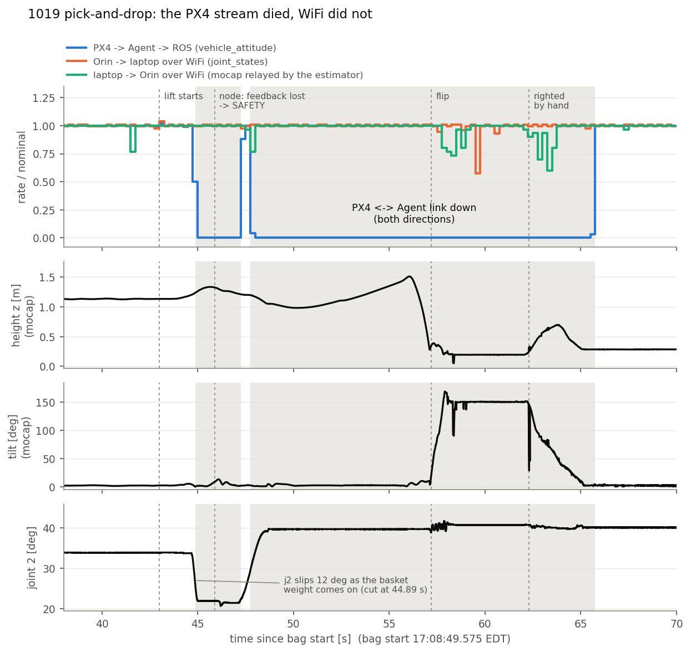

# 2026-10-19 pick-and-drop: "WiFi issue" after the pick — what the bags show

Bags: `docs/experimental_data_ros2_bag/1019 - T650-AM whole-body Pick&Drop [Fail, WIFI]-*/`
- `flight_wb_l1_4d_pick_and_drop_20261019_170849` (**PD**, 85 s) — the failed pick-and-drop
- `flight_wb_l1_4d_pick_and_drop_20261019_172008` (**HV**, 101 s) — the whole-body hover test afterwards

Stack: the FUSED whole-body 4-D hardware stack (`AM_HW_PROFILE=pick_and_drop`), Agent over UDP/Ethernet
(`start_microxrce_agent.sh udp 8888`), recorder + mocap processor + both ground stations on the laptop.



## Verdict

**It was not WiFi. The PX4 ↔ MicroXRCE-Agent link (Pixhawk Ethernet ↔ Orin) went dead in both
directions, twice: 2.4 s from 44.89 s and 18.0 s from 47.76 s.** WiFi between the Orin and the laptop
carried every ROS topic at full rate through the whole blackout.

| stream (receive time at the laptop) | during the PX4 blackout |
|---|---|
| `/uav_0/fmu/out/*` (PX4 → Agent) and everything derived from it (estimator imu/odom, planner `current_ee`) | **absent** 44.889–47.265 s and 47.759–65.746 s |
| Orin → laptop WiFi (flight node 250 Hz, arm 250 Hz, planner) | full rate; extra delay p99 1.7 ms, worst 46 ms |
| laptop → Orin WiFi (mocap → Orin estimator → `fmu/in/vehicle_visual_odometry`) | full rate; latency p50 0.9 / p99 4.2 / max 9.8 ms |
| Orin → PX4 (`fmu/in/*`, 100–250 Hz) | published normally on the Orin, **not received by PX4** (PX4 reported an offboard-loss failsafe, nav POSCTL, at 47.29 s) |

How the direction was established: the recorder is on the laptop — `/uav_0/mocap` (published on the
laptop) arrives 0.2 ms after its stamp with sub-ms jitter, while every Orin-published topic shares the same
WiFi delay spikes (3.0, 23.5, 44.55, 59.6 s) that the laptop topics do not have. And the flight node ON
THE ORIN reported the PX4 odometry stale (`POSITION FEEDBACK LOST ... odom age 1.01 s ... PX4 fused
odometry is ALSO stale`), so PX4 data stopped reaching processes on the Orin too.

The cut was clean: PX4's clock advanced exactly as much as the gaps (2.375 / 17.989 s — no reboot),
latency was normal (0.6 ms) up to the last sample, and nothing backlogged afterwards. The `timesync`
offset re-converged (+4.3 ms) when the stream returned at 65.75 s, consistent with PX4's client
re-establishing its session.

## Sequence (bag time, +17:08:49.575 EDT)

| t [s] | wall | event |
|---|---|---|
| 42.38–42.99 | | gripper closes on the stem, Exit To Pick starts (automatic) — 20 cm climb |
| ~44.5–44.9 | | basket leaves the pillar; **joint 2 slips 33.8 → 22.0° (−54°/s)** as its weight comes on |
| **44.889** | 17:09:34.46 | **PX4 stream stops** (both directions) |
| 45.89 | | flight node: feedback lost (odom age 1.01 s) → **DIRECT → SAFETY**; planner "NOT IN DIRECT, targets dropped" — **this is why the arm GS could not be operated**: its Pick & Drop steps are disabled outside DIRECT |
| 45.90–48.7 | | SAFETY guard folds the arm home (with the basket hooked) |
| 47.265–47.759 | 17:09:36.84–37.33 | link back for 0.49 s: PX4 shows offboard-loss failsafe (POSCTL) then OFFBOARD again |
| **47.759** | 17:09:37.33 | **link down again, 18.0 s** — PX4 alone, with neither offboard input nor mocap (EV) |
| 48–56 | | vehicle sinks to 1.0 m, climbs to 1.5 m, and from 53 s accelerates ~4 m toward (−2.8, −1.9) at up to 1.2 m/s |
| 56.1–57.5 | | drops 1.5 → 0.3 m and **flips** (tilt 10 → 167°), lies inverted to 62 s |
| 62.3–65.0 | | rolled upright and lifted to 0.65 m over 2.5 s (by hand), set down |
| **65.746** | 17:09:55.32 | PX4 stream returns; first status already **disarmed**, STAB |

What PX4 did between 47.8 and 65.7 s (failsafe mode chain, when it disarmed, whether the drop at 56 s was
the pilot) is only in the **PX4 ulog** — the bag has no PX4 data for that window.

## CPU health

There is no CPU topic in the bags (`fsc_system_monitor` publishes `/uav_0/system_monitor/status`, but it is
not in the recorder's list). Each core's real-time loop was checked through its own publish timestamps
(independent of WiFi), PD bag, whole flight including the blackout:

| core | process | loop | result |
|---|---|---|---|
| 5 | flight node executor (FIFO 80) | `fmu/in/actuator_motors` 250 Hz | median 4.00 ms, worst **5.0 ms**, 0 late |
| 4 | Agent + the node's DDS threads | node's receive freshness in DIRECT during 44.89–45.89 s | planner stream, arm reference and arm velocity observer **all fresh** — the core was not monopolised |
| 3 | arm controller_manager (FIFO 50) | `joint_states` 250 Hz; arm "Loop health" | 1 late in 37 503 cycles (before the flight); the only gaps (≤ 100 ms) are 57.6–60.6 s, the vehicle lying inverted after the crash, no servo errors |
| 0–2 | estimator | mocap relay | latency p50 1.0 / p99 3.6 ms |
| 2 | planner | `current_ee_body` 15 Hz | worst 72 ms vs 66.7 nominal, 0 late |

**No sign of a saturated core anywhere.** CPU 4 (the Agent) is the one core whose load cannot be read from
the bag; its core-mates kept working, so a FIFO-style livelock (2026-10-11) is ruled out, but a slower
Agent problem is not. The HV bag is clean on every count (WiFi worst 20 ms Orin→laptop / 49 ms
laptop→Orin, PX4 400 Hz with no gap over 40 ms).

## Box-pushing code vs the pick-and-drop task

Diffed against the 10-16 flight builds (fsc_autopilot_ros2 `f6395dd`, planner `2074d3e`, arm `ed67281`):
- `scripts/realtime/` (CPU map, RT launch, DDS profile): **unchanged**. The arm launcher: unchanged.
- Stack scripts: the box-pushing / valve additions are profile-gated checks and refusals; nothing new runs
  for `pick_and_drop`.
- Planner: one shared hunk (tilt guards) — with push-and-pull not engaged the pick-and-place guard
  behaves exactly as before; the new streaming branch needs `push_pull_follow`. No planner guard fired today.
- What DID change for this flight, none of it networking: the j4 heading fix (`wb_ky/dy_psi` 2.5/0.93 +
  `wb_l1_stuck_hold_j4`, first hardware flight), the arm's j1 friction relay 2.9 → 0, and
  `wb_ee_anchor_blend_s` now actually loaded (1.0 = the default that flew before).

## History of this signature

`/fmu/out` gaps > 0.3 s in every hardware bag since 09-09, each checked for THIS signature (PX4 topics
absent while the Orin's own topics keep arriving):

| date | bag | PX4 link down | where | same signature |
|---|---|---|---|---|
| 09-12 | `flight_wb_l1_20260912_201430` | 4.1 s | — | **no**: every Orin topic gapped too = WiFi / Orin side |
| 10-05 | `flight_decoupled_l1_figure8_vel010_..._163734` | 4.8 + 1.0 s | on the ground, just landed (z 0.23) | yes |
| 10-09 | PP-2 `..._180228` | 5.2 s | **in flight**, 1.0 m hover | yes |
| 10-09 | PP-3 `..._181817` | to the bag end | on the ground, 7 s after disarm | yes |
| 10-10 … 10-16 | nine flights | none | | |
| 10-19 | `..._170849` | 2.4 + 18.0 s | **in flight**, basket lift | yes |

So this is the **second in-flight occurrence and the fourth overall**. The 10-09 freezes were attributed
to the Agent's FIFO 70 livelock (fixed `71ec97a`): that explained why the link stayed dead, not what cut
it. Today the Agent recovered on its own (the fix working), but the cut itself recurred. Two of the four
happened on the ground with the motors off, which argues against interference at peak electrical load
and toward the cable/connector or the software path (Agent / PX4 client).

## Cable signal quality while the link is up

`tools/eth_loss.py` over the ten flights 10-14 … 10-19: every hole in PX4's 400 Hz `sensor_combined` is
also in the Orin's own republished copy (`enu/imu/data`), so these losses happen before the Orin's ROS
side, not on WiFi. They are few and are whole-stream STALLS, not scattered single frames:
- one ~35 ms hole (14 samples) ~0.3 s after **every disarm**, in all ten flights — PX4 closing its ulog;
- a handful of 25–75 ms stalls in flight (10-16 D-1 had 4, today 3 before the cut).

A cable with poor signal integrity (split pair, untwisted run beside power leads) drops individual frames
at random; none of that is seen. **If the cable is the cause, it is an intermittent CONTACT (all or
nothing: crimp, connector, strain), not a noisy signal.**

## What is still unknown — and the evidence that settles it

The bag cannot tell a physical Ethernet drop (hand-made JST-GH → RJ45 cable, connector, EMI at peak
load) from an Agent or PX4-client stall. Three logs can, all for **17:09:34 – 17:09:56 EDT**
(epoch 1792444174.5 – 1792444195.4):

1. **Orin kernel** — a physical drop prints there:
   `journalctl -k --since "2026-10-19 17:05" --until "2026-10-19 17:12" | grep -iE "enP8p1s0|r8169|r8168|link"`
   plus `cat /sys/class/net/enP8p1s0/{carrier_changes,carrier_down_count}` and
   `ip -s link show enP8p1s0` (errors / drops), if the Orin has not been rebooted since.
2. **Agent pane** — `tmux attach -t fsc_microxrce_agent`, scroll back to `[17924441..]` lines
   (`create_client` / `delete_client` / session events) around those epochs.
3. **PX4 ulog** of that flight — when EV fusion stopped (the Orin → PX4 direction), the failsafe chain
   and disarm, the battery current at 44.9 s, `cpuload`, and the logged messages.

## Tools

```bash
set +u; source /opt/ros/humble/setup.bash; source ~/ros2_ws/rosdeps/local_setup.bash; source ~/ros2_ws/install/setup.bash
/usr/bin/python3 tools/extract_timing.py <bag dir> npz/pd.npz     # per-topic receive time + header/PX4 stamps
/usr/bin/python3 tools/timeline_prep.py                           # -> npz/timeline.npz
PYTHONNOUSERSITE=1 /usr/bin/python3 tools/fig_timeline.py         # -> figures/timeline.png
```
